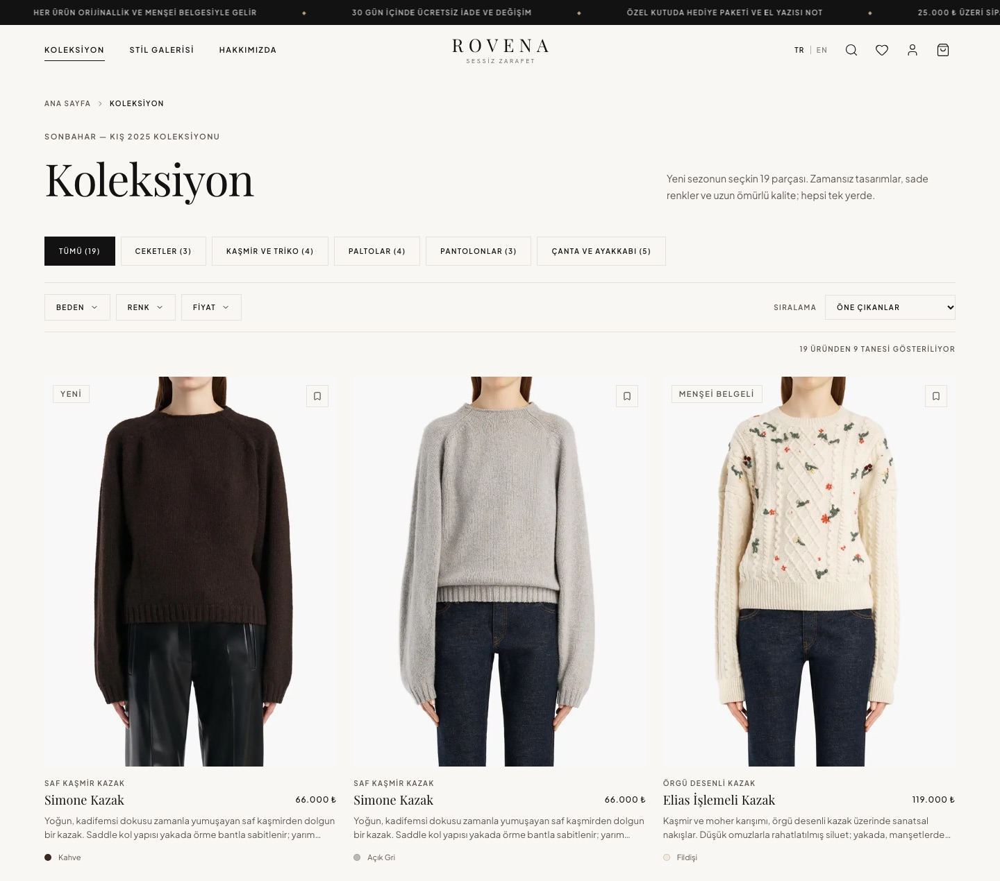
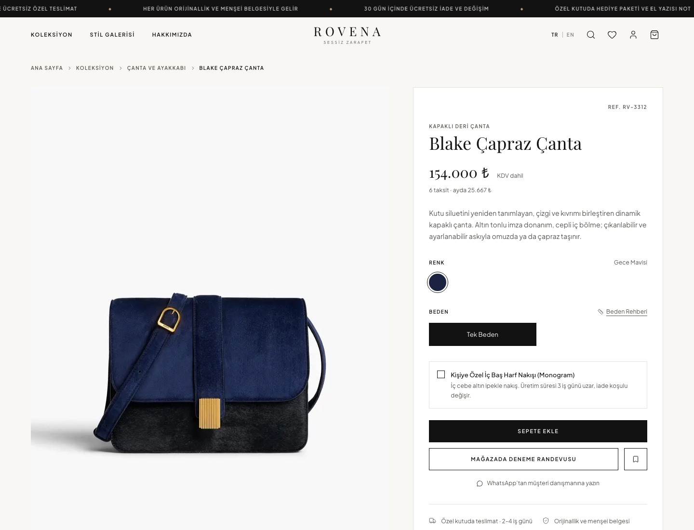
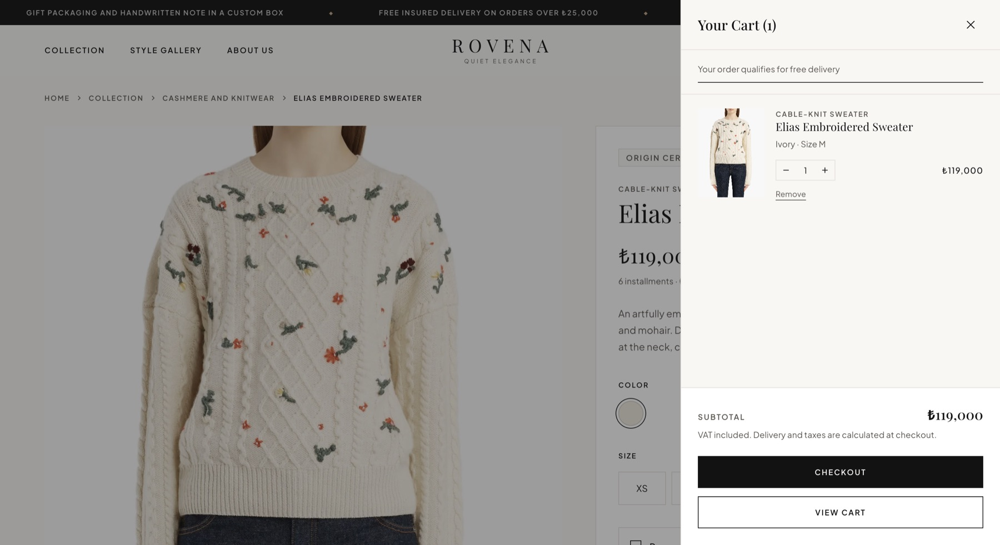
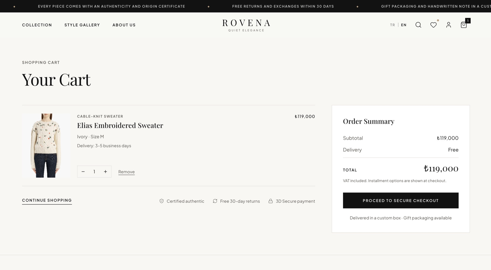
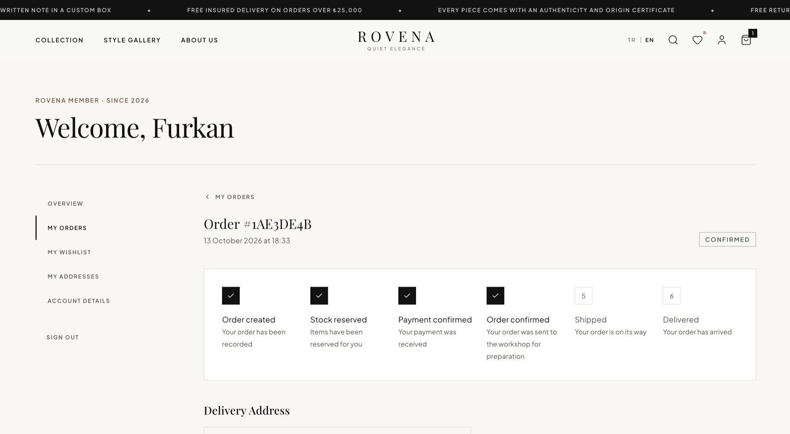
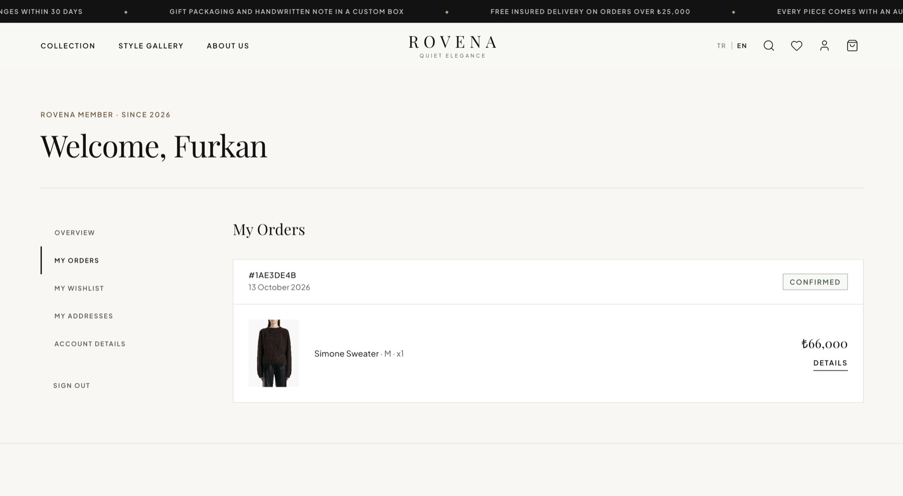
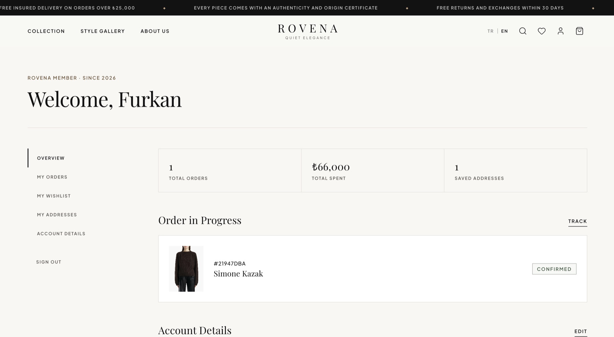
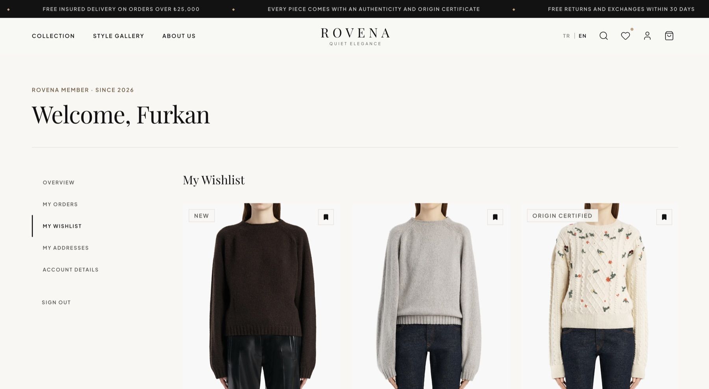
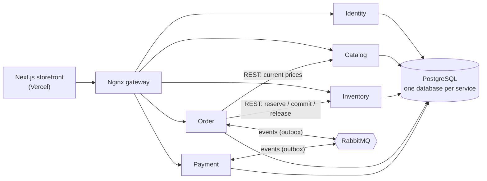
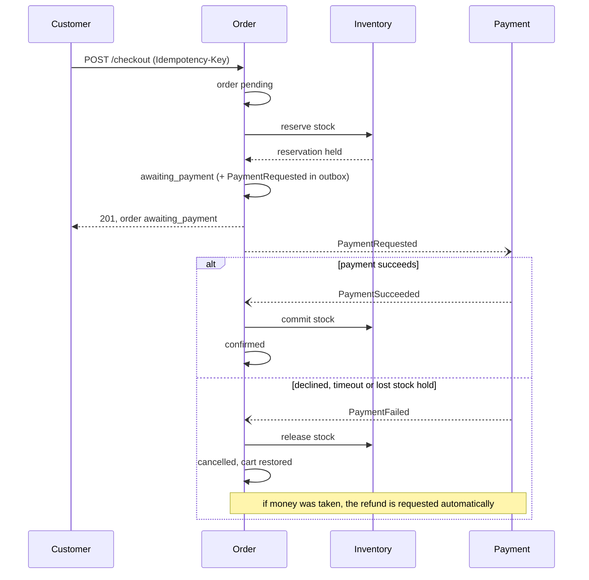

# Rovena

A fashion and accessories e-commerce platform, built as a **production-style microservices system**: five Go services, event-driven order processing with a Saga, and a bilingual (TR/EN) Next.js storefront.

**Live demo:** https://rovena-eight.vercel.app (Turkish and English). Payments are simulated; use the test cards below.

Rovena is a portfolio project. Its goal is to show how a real online shop behaves when its parts can fail independently: payments that are declined or never answered, a message broker that goes down, a service that restarts mid-order. The checkout stays correct in all of them, and there are tests that prove it.

## Highlights

- **Five services, five databases.** Identity, Catalog, Inventory, Order and Payment each own their data. No service reads another one's tables; they talk over REST and RabbitMQ events.
- **Checkout as a Saga.** Reserve stock, request payment, confirm or compensate (release stock, refund). Repeating a request with the same `Idempotency-Key` never creates a second order or a second charge.
- **Transactional Outbox + idempotent consumers.** Events are written in the same transaction as the state change and published afterwards, so a crash cannot lose or duplicate a step.
- **Self-healing.** A recovery job repairs orders stuck between steps. Late payments for cancelled orders are refunded automatically.
- **Tested against real infrastructure.** 400+ Go tests, integration tests on real PostgreSQL and RabbitMQ, and 19 end-to-end scenarios that stop and restart real containers (RabbitMQ outage, service restarts, lost messages, duplicate events).
- **Observable.** W3C trace context flows through HTTP and through the outbox into events: one trace covers a whole order in Jaeger. Prometheus metrics, alert rules and a Grafana dashboard are included.
- **Storefront with real behaviour.** Catalog, per-variant stock, accounts, address book, cart, checkout with live order tracking, order history with shipment status.

## Screenshots

| Home | Collection |
| --- | --- |
|  |  |
| **Product** | **Cart drawer** |
|  |  |
| **Cart** | **Order tracking** (Saga steps, then shipment) |
|  |  |
| **My orders** | **Account overview** |
|  |  |

**Wishlist**



## Architecture



### The checkout Saga



After `confirmed`, an operator moves the order to `shipped` (carrier and tracking code) and `delivered`.

## Tech stack

| Area | Technology |
| --- | --- |
| Backend | Go, Fiber, Bun (PostgreSQL), goose migrations |
| Messaging | RabbitMQ, Transactional Outbox, idempotent consumers, retry and dead-letter queues |
| Frontend | Next.js 16 (App Router), React 19, TypeScript, Tailwind CSS v4, Motion |
| Auth | JWT access tokens + rotating opaque refresh tokens, httpOnly cookies, role-based access |
| Infrastructure | Docker Compose, Nginx gateway, GitHub Actions CI |
| Observability | OpenTelemetry, Jaeger, Prometheus, Grafana |
| API contracts | OpenAPI documents with a contract test against the running stack |

## Services

| Service | Responsibility |
| --- | --- |
| **Identity** | Registration, login, refresh and logout, profile, password and email change, address book, roles |
| **Catalog** | Products, variants, categories, search, filters and sorting, translations (TR/EN) |
| **Inventory** | Per-variant stock, reservations with expiry, stock movements |
| **Order** | Cart, checkout Saga, order lifecycle, cancellation, shipment status, recovery job |
| **Payment** | Provider abstraction with a fake provider (no real payments), refunds |

## Run it locally

Requirements: Docker, Go (for tests), Node.js 20+.

```bash
cd backend
cp .env.example .env        # fill in every value (JWT_SECRET: openssl rand -base64 48)
make up                     # databases, RabbitMQ, services, gateway, Jaeger, Prometheus, Grafana
make seed-admin             # first admin from ADMIN_EMAIL / ADMIN_PASSWORD
make seed-catalog           # demo catalog (needs MEDIA_BASE_URL in .env)
make seed-inventory         # opening stock for every variant
```

```bash
cd frontend/web
cp .env.example .env.local  # API_BASE_URL=http://localhost:18080, NEXT_PUBLIC_MEDIA_URL=...
npm install
npm run dev -- -p 3100
```

| What | Where |
| --- | --- |
| Storefront | http://localhost:3100 |
| API gateway | http://localhost:18080 |
| Jaeger (traces) | http://localhost:16686 |
| Grafana / Prometheus | http://localhost:3000 / http://localhost:9090 |
| RabbitMQ management | http://localhost:15672 |

Test cards (fake provider): `4242 4242 4242 4242` succeeds, `4000 0000 0000 0002` is declined, `4000 0000 0000 9995` has insufficient funds. The card number never leaves the browser; only a provider token is sent, and only that token is stored.

## Tests and CI

```bash
cd backend
make test               # unit and HTTP tests in every module
make test-integration   # real PostgreSQL and RabbitMQ
make e2e                # end-to-end and fault-injection scenarios
make lint               # golangci-lint
```

GitHub Actions runs build and vet, `go mod tidy` check, gofmt, golangci-lint, govulncheck, unit tests, integration tests, OpenAPI validation and the end-to-end scenarios on every push to `main` and on pull requests.

## Documentation

| Document | Contents |
| --- | --- |
| [`docs/architecture.md`](docs/architecture.md) | System design and the decisions behind it |
| [`docs/readme.md`](docs/readme.md) | API surface and operations reference |
| [`docs/openapi/`](docs/openapi/README.md) | OpenAPI documents for every service |
| [`docs/deploy.md`](docs/deploy.md) | Deploying the backend to a VPS and the storefront to Vercel |
| [`docs/notes/`](docs/notes/00-icindekiler.md) | A step-by-step guide to the whole project for readers new to microservices (in Turkish) |
| [`docs/saga-lab/`](docs/saga-lab) and [`docs/observability-lab/`](docs/observability-lab) | Interactive labs that teach the Saga and the observability stack, no build step (serve `docs/` with `python3 -m http.server`) |

## Repository layout

```text
rovena/
├── backend/
│   ├── services/           identity, catalog, inventory, order, payment (own go.mod and database each)
│   ├── shared/             common Go module: errors, HTTP, auth, messaging, outbox, telemetry
│   ├── infrastructure/     Nginx gateway, PostgreSQL init, Prometheus, Grafana
│   ├── e2e/                end-to-end and fault-injection scenarios
│   └── docker-compose.yml
├── frontend/web/           Next.js storefront (TR/EN)
└── docs/
```

## Notes

- Payments are simulated; no real money moves and no card data is stored.

