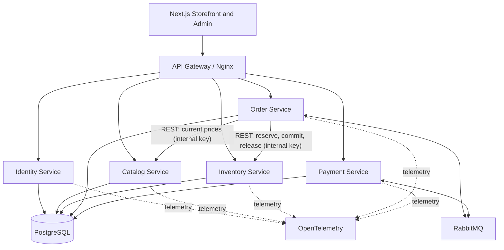
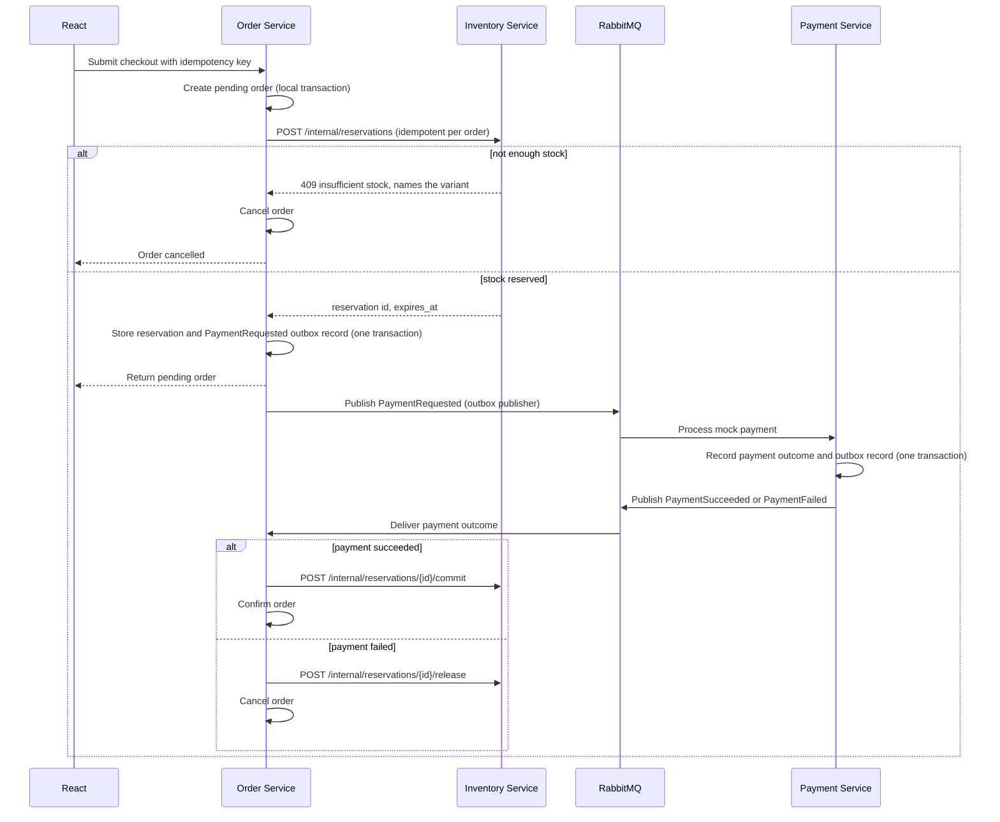

# Rovena — System Architecture

## 1. Overview

Rovena is a fashion and accessories e-commerce marketplace built using Go, React, TypeScript, PostgreSQL, and RabbitMQ.

The system follows a domain-oriented microservices architecture. Each service owns a distinct business capability and its associated data. Services communicate synchronously through REST APIs and asynchronously through domain events.

The initial architecture prioritizes clear service boundaries, reliability, testability, and operational simplicity. Kubernetes, service meshes, and other advanced infrastructure are intentionally excluded from the initial implementation.

## 2. High-Level Architecture



Each service uses its own database and credentials, even when services share a PostgreSQL server in the development environment. Services must not directly query or modify another service's tables.

The API Gateway provides a single entry point for routing and basic request protections. Business authorization remains the responsibility of the relevant backend service.

## 3. Service Responsibilities

### 3.1 Identity Service

Responsibilities:

* User registration and authentication
* Credential management
* User profiles
* Roles and authorization-related identity data
* Issuing or validating authentication tokens

Owns:

* Users
* Credentials
* Roles and identity-related records

Security requirements:

* Secure password hashing
* Explicit authorization checks
* Rate limiting for sensitive authentication endpoints
* No plaintext credentials or tokens in logs

### 3.2 Catalog Service

Responsibilities:

* Product management
* Categories and product attributes
* Product variants, such as size and color
* Product descriptions and image references
* Product search, filtering, and pagination

Owns:

* Products
* Categories
* Product variants
* Catalog metadata

The Catalog Service owns product descriptions and commercial catalog information. Inventory quantities are owned exclusively by the Inventory Service.

### 3.3 Inventory Service

Responsibilities:

* Stock availability
* Stock reservations
* Stock release and adjustment
* Inventory movement records
* Prevention of overselling

Owns:

* Stock records
* Reservations
* Inventory movements

Stock-changing operations must be concurrency-safe. Database transactions and conditional updates or appropriate row locking are used to preserve inventory invariants.

Reservations have explicit states and expiration or recovery rules.

### 3.4 Order Service

Responsibilities:

* Shopping cart management
* Checkout initiation
* Order creation and lifecycle management
* Order item snapshots
* Checkout workflow coordination
* Handling inventory and payment outcomes

Owns:

* Carts and cart items
* Orders
* Order item snapshots
* Order status history
* Checkout workflow state
* Outbox records for order-related events

Order items preserve the product name, variant, quantity, and purchase price at the time of the order. Historical orders must not change when catalog information changes.

The Order Service coordinates the checkout Saga and does not directly modify inventory or payment data.

The cart stores only variant ids and quantities. Names and prices are looked up in Catalog (an internal lookup endpoint) whenever the cart is shown and when an order is placed, so a client can never set a price. A checkout needs an `Idempotency-Key`; the same key returns the same order. The order is created in the same transaction that empties the cart, and only if the cart still holds exactly the lines that were priced.

Order status moves `pending` -> `awaiting_payment` -> `paid` -> `confirmed`, or to `cancelled` from any of the first three. A customer can cancel while the order is `pending` or `awaiting_payment`; the items return to the cart after every cancellation except the customer's own. The order's belief about its stock reservation (`none`, `held`, `committed`, `released`) is tracked separately, so a half-finished compensation (cancelled but still holding stock) can be found and finished. Every transition is guarded (it applies only from the expected status) and queues its event in the same transaction.

### 3.5 Payment Service

Responsibilities:

* Payment initiation and status tracking
* Payment attempt records
* Provider abstraction
* Simulated payment success and failure
* Idempotency and duplicate request protection
* Publishing payment result events
* Read-only payment status API (customer, admin, internal); payments are created only by `PaymentRequested` events, never over HTTP

Owns:

* Payment attempts
* Payment state
* Payment-related idempotency records

The initial implementation uses a mock payment provider whose answer is selected by a test card token. No real payments are processed. A provider that fails to answer is retried a bounded number of times and then the payment fails with `provider_unavailable`, so the order always receives a definite result. An order can be paid at most once.

The payment abstraction must allow a future provider adapter without coupling order business logic to a specific payment vendor.

## 4. Service-Level Project Structure

Each Go service follows a consistent internal structure, adapted to its actual responsibilities.

```text
services/
└── catalog/
    ├── cmd/
    │   └── api/
    │       └── main.go
    ├── internal/
    │   ├── domain/
    │   ├── application/
    │   ├── transport/
    │   │   └── http/
    │   ├── repository/
    │   └── infrastructure/
    ├── migrations/
    ├── tests/
    ├── Dockerfile
    ├── go.mod
    └── go.sum
```

Layer responsibilities:

* **Domain:** Business entities, invariants, domain errors, and core business rules.
* **Application:** Use cases, orchestration, and transaction boundaries.
* **Transport:** HTTP handlers, request validation, DTOs, and response mapping.
* **Repository:** Data access contracts and persistence implementations where appropriate.
* **Infrastructure:** Database connections, message broker integration, logging, and external adapters.

Dependencies should point toward business rules rather than framework details. Domain logic must not depend on HTTP handlers, PostgreSQL implementations, or RabbitMQ clients.

Avoid unnecessary abstractions. Interfaces should be introduced where they define a meaningful boundary or enable testing and alternative implementations.

## 5. Frontend Structure

```text
frontend/
├── src/
│   ├── app/
│   ├── components/
│   ├── features/
│   │   ├── catalog/
│   │   ├── cart/
│   │   ├── checkout/
│   │   ├── orders/
│   │   ├── account/
│   │   └── admin/
│   ├── lib/
│   ├── services/
│   └── types/
├── public/
├── package.json
└── vite.config.ts
```

The frontend is organized by feature. API clients, shared components, and common types should be separated from feature-specific implementation details.

The frontend is not trusted to enforce business rules. Prices, discounts, permissions, stock availability, and order totals must be validated or calculated by the backend.

## 6. Communication

### Synchronous communication

REST/HTTP is the default for request-response operations, such as:

* Retrieving product details
* Loading a user's cart
* Retrieving order history
* Administrative product management
* Stock reservations during checkout (Order to Inventory), because the caller needs the answer immediately: either the stock is held or it is not, and which item is missing

Service-to-service calls must have explicit timeouts, error handling, and bounded retries where appropriate.

Retries must not blindly repeat non-idempotent operations.

### Asynchronous communication

RabbitMQ carries domain events and commands used in workflows that do not require an immediate response.

Initial event examples:

* `PaymentRequested`
* `PaymentSucceeded`
* `PaymentFailed`
* `OrderConfirmed`
* `OrderCancelled`

Stock reservation is intentionally not an event flow (see section 7 and the "Hybrid checkout" decision in section 13): Inventory exposes idempotent REST endpoints instead, so there are no `StockReserved` or `StockReservationFailed` events.

Event payload contracts (type names, versions, fields) live in `backend/shared/events`. Events should have a stable envelope containing an event ID, event type, schema version, timestamp, and relevant identifiers.

Events represent facts that have occurred. Commands request that a service perform an action. These concepts must remain distinct.

Consumers must tolerate duplicate message delivery. Message handling should be idempotent, and poison messages should eventually be routed to a dead-letter queue for investigation.

## 7. Checkout and Saga

Checkout spans multiple independently committed service transactions. A single PostgreSQL transaction cannot atomically cover the entire workflow.

The Order Service coordinates a Saga. It is a hybrid: **stock is reserved with a synchronous REST call**, **payment travels over RabbitMQ**.

Why the split: a reservation either succeeds or fails right now, and the customer needs to know which item is missing, so a request/response call is the natural fit. Payment, in contrast, is slow and may involve retries, so it benefits from an asynchronous, durable message with an outbox.



Workflow rules:

1. Create an order in a pending state in a local database transaction.
2. Reserve inventory before asking for payment. Reserving is idempotent per order id, so a retried or timed-out call is safe.
3. Persist the reservation and the `PaymentRequested` event in the same local transaction (Transactional Outbox).
4. Process payment through the Payment Service, which answers with an event.
5. On payment success, commit the reservation and confirm the order. On failure, release the reservation and cancel the order.
6. Make every step and compensation idempotent: commit and release can be repeated, events can be delivered twice.

Failure and recovery:

* Inventory releases a reservation by itself when it expires (default 15 minutes), so an abandoned checkout never holds stock forever.
* Order must not leave an order pending indefinitely: a recovery job finds orders that are stuck (no payment outcome after a timeout, or a crash between two steps), then retries the missing step or cancels the order and releases the reservation.
* If the release call itself fails, it is retried; the expiry above is the final safety net.

Timeouts, retry counts and the recovery schedule (all configurable, these are the defaults):

| Setting | Default | Meaning |
| --- | --- | --- |
| Catalog / Inventory call timeout | 5 s | One attempt per call; retrying is the recovery job's task |
| `ORDER_RECOVERY_INTERVAL` | 15 s | How often the recovery job runs |
| `ORDER_STUCK_AFTER` | 30 s | An order unchanged for this long is looked at |
| `ORDER_PENDING_MAX_AGE` | 5 min | A `pending` order that still has no stock reservation is cancelled (`checkout_timeout`) |
| `ORDER_PAYMENT_TIMEOUT` | 2 min | Wait this long for a payment answer before asking again |
| `ORDER_MAX_PAYMENT_REQUESTS` | 3 | After the last request stays unanswered for the timeout, the order is cancelled (`payment_timeout`) and its stock released |

All payment requests for one order carry the same idempotency key (`order:<id>`), so asking again can never charge twice.

**Refunds.** When a payment succeeds after its order was cancelled (late success, the customer cancelled while it was in flight, or the stock hold had expired), Order asks Payment for a refund (`RefundRequested`) and records the answer (`PaymentRefunded`). The request is repeated a bounded number of times if unanswered; after that an alert tells a person. A second charge that raced past the "already paid" check is refunded by Payment itself.

**Housekeeping.** Published outbox rows and old inbox markers are deleted after `OUTBOX_RETENTION` (7 days by default); unpublished rows are never deleted.

## 8. Reliability Patterns

### Transactional Outbox

When a service changes its database state and needs to publish an event, the business update and outbox record are written in the same local transaction.

A separate publisher sends pending events to RabbitMQ and marks them as published. Since a publisher may crash after sending an event but before marking it as published, consumers must be idempotent.

### Idempotency

Checkout requests and payment operations must support stable idempotency keys.

Message consumers should record processed event IDs or use equivalent transactional deduplication techniques. Database constraints should enforce important uniqueness guarantees.

### Retries and Dead-Letter Queues

Retry transient failures with bounded attempts and backoff. Permanent validation failures should not be retried indefinitely.

Messages that exhaust their retry policy should be moved to a dead-letter queue and made observable for operational investigation.

### Data Consistency

Each service owns its database writes. Cross-service workflows use events and compensating actions rather than distributed database transactions.

Read models may temporarily lag behind source-of-truth services. APIs and the user interface must handle pending states and eventual consistency explicitly.

## 9. Data and Infrastructure

### PostgreSQL

A PostgreSQL server may host multiple service databases locally. Each service has separate credentials and migrations.

Production deployments may use separate database instances where isolation, scaling, security, or availability requirements justify the additional infrastructure.

### Redis

Redis is optional and should be introduced only when a measurable use case exists, such as caching or distributed rate limiting.

PostgreSQL remains the source of truth for orders, inventory, and payment state.

### Docker Compose

Docker Compose runs the local development environment, including the Go services, frontend, PostgreSQL, RabbitMQ, and gateway.

Services should expose health and readiness endpoints. Startup order alone must not be treated as proof that a dependency is ready.

### Observability

Use structured logs and OpenTelemetry traces and metrics.

Propagate correlation and trace context across HTTP requests and message headers. Monitor API latency, error rates, consumer backlog, retry counts, checkout failures, and reservation expiration.

Do not log passwords, authentication tokens, or sensitive payment data.

## 10. Security

* Validate and authorize every protected backend operation.
* Enforce role-based permissions in the relevant service.
* Use parameterized database queries.
* Validate incoming requests and apply request size limits.
* Configure CORS, cookies, and transport security deliberately.
* Store secrets outside source control.
* Apply rate limiting to sensitive and resource-intensive endpoints.
* Verify event origin and access to broker credentials.
* Never trust client-supplied prices or payment success indicators.
* Use least-privilege database and infrastructure credentials.

## 11. Testing Strategy

Each service should include:

* Unit tests for business rules
* Integration tests for persistence and transaction behavior
* API tests for request validation and authorization
* Consumer tests for event processing and idempotency
* Failure-path tests for retries and compensation

End-to-end tests should cover the complete checkout lifecycle, including insufficient stock, failed payment, duplicate requests, repeated events, and service interruptions.

## 12. Deployment and Evolution

The initial deployment model uses Docker Compose and a CI pipeline that builds services and runs tests.

Kubernetes, service meshes, Kafka, and other advanced infrastructure are not part of the initial scope.

New infrastructure should be introduced only when a clear requirement justifies it.

Service boundaries may evolve as domain knowledge grows. Splitting a service further requires a concrete business, scaling, ownership, or reliability benefit.

## 12a. Observability

* **Traces:** OpenTelemetry. The W3C `traceparent` travels in HTTP headers and in the event envelope, so a trace survives the outbox (an event is published long after the request that created it) and continues in the consumer and in the events the consumer publishes.
* **Metrics:** Prometheus format on each service's `/metrics` (not routed by the gateway): request count and latency by route template, outgoing call latency, events published/consumed (with retry and dead-letter results), handler duration, outbox backlog size and age, queue depth (RabbitMQ plugin), orders and payments by outcome, recovery actions.
* **Logs:** structured JSON; lines written with a request context carry `trace_id`.
* Labels never contain ids or raw URLs.

## 13. Architecture Decisions

* **Microservices over a single monolith:** Chosen to learn independent service boundaries, distributed communication, and failure handling.
* **Go for backend services:** Provides a consistent implementation language across the system.
* **REST for synchronous APIs:** Keeps contracts straightforward and accessible.
* **RabbitMQ for asynchronous workflows:** Supports event-driven integration without requiring a Kafka cluster.
* **PostgreSQL per service:** Establishes clear data ownership while allowing a shared local database server.
* **Mock payment provider:** Enables realistic payment workflow development without processing real payments.
* **Hybrid checkout:** Stock reservation is a synchronous, idempotent REST call from Order to Inventory because its result is needed immediately and must name the failing item; payment is asynchronous over RabbitMQ. This keeps Inventory free of a message consumer and avoids a second saga participant waiting for events.
* **Saga and Transactional Outbox:** Address cross-service consistency and reliable event publication.
* **Guarded transitions instead of an Inbox in Order and Payment:** Their real effect is a call to another service, which a database transaction cannot cover. Idempotency comes from the state machine (an update applies only from the expected state) and from idempotent downstream calls.
* **Stock records are opened by hand, not by an event:** A new Catalog variant does not create an Inventory record automatically (the initial quantity is a business input Catalog does not have, and an event would give Inventory its first consumer). A variant without a record shows as out of stock and is refused at checkout.
* **HS256 shared secret for tokens, for now:** An asymmetric scheme (Ed25519, public keys for verifiers) was evaluated and postponed until services get separate secret stores; see `docs/notes/17-iade-iptal-ve-temizlik.md` for the migration plan.
* **Order never trusts the client's prices:** The cart holds ids and quantities; prices come from Catalog at display time and at checkout, and the order keeps its own snapshot.
* **Docker Compose first:** Keeps local development reproducible without premature orchestration complexity.

The guiding principle is to keep the system distributed where independent business ownership is valuable, while avoiding infrastructure and abstractions that do not serve a concrete purpose.
