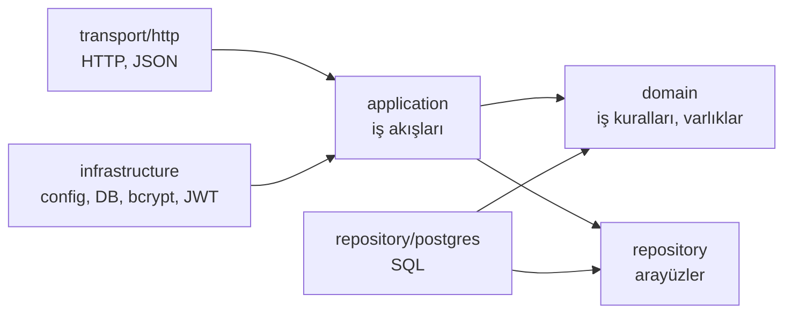

# 05 - Identity servisi: katmanlar ve dosyalar

Identity, "kim bu kullanıcı?" sorusundan sorumlu servistir: kayıt, giriş, profil, roller. Diğer servisler de aynı katman düzenini kullanacak; bu yüzden bu bölümü iyi anlamak önemlidir.

## Neden katmanlar?

Kodu "ne işe yaradığına" göre ayırırız ki bir değişiklik her yeri etkilemesin. Örneğin veritabanını Postgres'ten başka bir şeye çevirmek, iş kurallarını (parola uzunluğu, son admin silinemez) değiştirmemeli.

Temel kural: **bağımlılıklar içeri doğru işaret eder.** Dış katmanlar iç katmanları bilir, iç katmanlar dış katmanları bilmez.



`domain` hiçbir şeyi import etmez (HTTP'yi, SQL'i bilmez). `application`, repository'nin **arayüzünü** (interface) bilir, Postgres'i bilmez. Postgres kodu o arayüzü gerçekler. Bu sayede testlerde gerçek veritabanı yerine sahte (fake) bir repository kullanabiliriz.

## Dosya haritası

```text
services/identity/
├── cmd/
│   ├── api/main.go         Web sunucusunu başlatır, her şeyi birbirine bağlar
│   ├── migrate/main.go     Veritabanı tablolarını kurar
│   └── seed/main.go        İlk admini oluşturur
├── internal/
│   ├── domain/             Çekirdek: varlıklar ve iş hataları
│   ├── application/        Kullanım senaryoları (servisler)
│   ├── repository/         Veri erişim sözleşmesi (interface)
│   │   └── postgres/       Sözleşmenin PostgreSQL gerçeklemesi
│   ├── transport/http/     HTTP katmanı: route, handler, DTO
│   └── infrastructure/     Dış dünya adaptörleri
│       ├── config/         Ortam değişkenlerini okur
│       ├── database/       Postgres bağlantısı
│       └── security/       bcrypt ve JWT
├── migrations/             SQL şema dosyaları (+ embed.go)
├── Dockerfile
├── go.mod / go.sum
```

## domain/

**`internal/domain/user.go`**

- `User`: id (UUID), email, parola hash'i, ad/soyad, rol, zaman damgaları. Düz Go struct'ı; veritabanı ya da JSON etiketi yok, çünkü domain bunlardan bağımsızdır.
- `Role`: `customer` veya `admin`. `Valid()` geçerli mi diye bakar.
- `RefreshToken`: oturumu yenilemeye yarayan kayıt (bkz. [06](06-kimlik-dogrulama.md)). `Expired(now)` süresi dolmuş mu diye bakar.
- Domain hataları: `ErrEmailTaken`, `ErrUserNotFound`, `ErrInvalidCredentials`, `ErrInvalidRefreshToken`, `ErrInvalidRole`, `ErrLastAdmin`, `ErrPasswordTooLong`. Bunlar HTTP durum kodu bilmez; "ne oldu"yu anlatır. HTTP'ye çevrilmesi transport katmanının işidir.

**Neden UUID?** Sıralı sayı (1, 2, 3) tahmin edilebilir ve servisler arası referansta çakışabilir. UUID v7 zamana göre sıralıdır, veritabanı indeksi için de uygundur.

## repository/

**`repository.go`**: Yalnızca arayüzler.

- `UserRepository`: `Create`, `GetByID`, `GetByEmail`, `List`, `UpdateProfile`, `UpdateRole`.
- `RefreshTokenRepository`: `Create`, `GetByHash`, `Revoke`, `RevokeAllForUser`.

**`postgres/`** bunların gerçeklemesidir:

- `models.go`: Tablolara karşılık gelen `userRow`, `refreshTokenRow` struct'ları (Bun ORM etiketleri burada) ve domain nesnesine dönüştürücüler. Böylece domain temiz kalır, veritabanı detayı sadece bu pakette yaşar.
- `user_repository.go`, `refresh_token_repository.go`: SQL sorguları (Bun ile, parametreli, yani SQL injection'a kapalı). Repository **iş kuralı içermez**; yalnızca veriyi okur/yazar. Tek istisna hata çevirisi: e-posta tekrarında Postgres'in "unique violation" (23505) hatasını `ErrEmailTaken`'a, bulunamayan satırı `ErrUserNotFound`'a çevirir.

## application/

İş akışlarının (use case) yaşadığı yer. HTTP bilmez, SQL bilmez.

**`ports.go`**: Application'ın dışarıdan ihtiyaç duyduğu iki yetenek için arayüz: `PasswordHasher` (hash/compare) ve `AccessTokenIssuer` (access token üret). Gerçeklemeleri `backend/infrastructure/security` içindedir.

**`auth_service.go`**: `AuthService`

- `Register`: e-postayı küçük harfe çevirip kırpar, parolayı hash'ler, rolü `customer` yapar, kaydeder, token çifti üretir. Parola 72 byte'tan uzunsa reddeder (bcrypt sınırı).
- `Login`: e-posta ve parolayı doğrular. Kullanıcı yoksa bile sahte bir hash'le karşılaştırma yapar; böylece cevap süresinden "bu e-posta kayıtlı mı" anlaşılamaz. Hatalı e-posta ve hatalı parola **aynı** hatayı döner.
- `Refresh`: refresh token'ı yeniler (rotasyon) ve yeniden kullanım tespiti yapar.
- `Logout`: refresh token'ı iptal eder; tekrar çağrılsa da hata vermez.

**`user_service.go`**: `UserService`

- `Get`, `UpdateProfile` (yalnızca ad/soyad; e-posta ve rol bu uçtan değişmez), `List`.
- `ChangeRole`: Rol geçerli mi bakar, kullanıcıyı bulur ve repository'ye yazdırır. **Sistemdeki son admin düşürülemez** kuralı repository'nin `UpdateRole` transaction'ında uygulanır (aşağıdaki "Eşzamanlılık" kutusu).

### Eşzamanlılık: "son admin" kuralı ve advisory lock

Kural ilk yazımda serviste şöyleydi: admin sayısını oku, birden fazlaysa rolü değiştir. İki admin **aynı anda birbirini** düşürürse ikisi de "2 admin var" görür, ikisi de düşürür ve sistemde **hiç admin kalmaz**. Bu, Catalog'daki varyant yarışıyla aynı kalıptır ([09](09-catalog-servisi.md)): kontrol et, sonra işlem yap (check-then-act).

Catalog'da korunan şey tek bir satırdı (ürün), satır kilidi yetiyordu. Burada kural **tüm tabloyla** ilgili ("toplamda en az bir admin"), yani hedef kullanıcının satırını kilitlemek yetmez: iki işlem farklı satırlara dokunuyor. Çözüm olarak `UpdateRole` transaction'ının başında bir **advisory lock** alınır (`pg_advisory_xact_lock`). Bu, belirli bir sayıya bağlı, uygulamanın tanımladığı bir kilittir ve transaction bitince otomatik bırakılır. Tüm rol değişiklikleri sıraya girer; ikincisi birincinin sonucunu görüp reddedilir. Rol değiştirme nadir bir admin işlemi olduğu için bu serileştirmenin maliyeti yoktur.

Test: iki admin 300 tur boyunca aynı anda birbirini düşürür; her turda tam olarak bir admin kalmalı ve tam olarak bir istek reddedilmelidir.

## transport/http/

HTTP dünyasını application'a çeviren katman.

- **`router.go`**: Fiber uygulamasını kurar. Global middleware sırası: request id, panic yakalama, access log, güvenlik başlıkları (helmet), CORS. Sonra route'lar:
  - `/api/v1/auth/*`: rate limit (dakikada IP başına 20), herkese açık
  - `/api/v1/users/me`: token gerekli
  - `/api/v1/users`, `/users/:id`, `/users/:id/role`: token + `admin` rolü gerekli
  - Ayrıca `/healthz` ve `/readyz`
- **`dto.go`**: DTO (Data Transfer Object) = API'nin dış şekli. İstek struct'ları doğrulama etiketleriyle (`validate:"required,email"`), cevap struct'ları. **Domain nesnesi doğrudan JSON olarak dönmez**; böylece `PasswordHash` gibi alanlar yanlışlıkla sızmaz ve API şeması iç yapıdan bağımsız kalır.
- **`auth_handler.go`**, **`user_handler.go`**: Handler'lar yalnızca şunu yapar: isteği oku/doğrula → application servisini çağır → cevabı DTO'ya çevir. İş mantığı yok. Hata olursa `return err`.
- **`errors.go`**: `MapDomainError`; domain hatalarını HTTP hatalarına çevirir (`ErrEmailTaken` → 409, `ErrInvalidCredentials` → 401, `ErrLastAdmin` → 409 ...). Shared'daki merkezi hata yakalayıcıya verilir.

## backend/infrastructure/

Dış dünyayla konuşan somut parçalar.

- **`config/config.go`**: Ortam değişkenlerini okur ve doğrular (`DATABASE_URL`, `JWT_SECRET` ≥ 32 karakter, token süreleri, bcrypt maliyeti vb.). Eksik/yanlış ayar varsa program daha başlarken durur.
- **`database/database.go`**: Postgres'e bağlanır, bağlantı havuzu ayarlar (en fazla 20 bağlantı), `Ping` ile doğrular.
- **`security/password.go`**: `bcrypt` ile parola hash'leme. Bcrypt bilerek yavaştır; çalınan bir veritabanından parola kırmayı pahalılaştırır.
- **`security/jwt.go`**: Access token üretir (HS256, 15 dk, içinde kullanıcı id ve rol).

## cmd/

- **`api/main.go`**: "composition root". Burası nesneleri oluşturup birbirine bağlayan tek yerdir: config → veritabanı → repository'ler → servisler → HTTP uygulaması. Sonra dinlemeye başlar. `SIGTERM` gelince (konteyner durdurulurken) yeni istek almayı bırakıp süren istekleri bitirir (graceful shutdown, 15 sn).
- **`migrate/main.go`**: `-action up|down|status`. `migrations/` içine gömülü (`embed`) SQL dosyalarını çalıştırır.
- **`seed/main.go`**: `ADMIN_EMAIL` ve `ADMIN_PASSWORD` ile ilk admini oluşturur. Zaten varsa dokunmaz. (Kayıt ucu herkese yalnızca `customer` rolü verir; admin bu yoldan olur.)

## Bağımlılıkların bağlanması (dependency injection)

`main.go` içinde şu zincir kurulur:

```text
Bun DB ─► UserRepository ─┐
Bun DB ─► RefreshTokenRepository ─┼─► AuthService ─► AuthHandler ─┐
BcryptHasher ─────────────────────┤                                ├─► Fiber app
JWTIssuer ────────────────────────┘     UserService ─► UserHandler ┘
```

Hiçbir nesne bağımlılığını kendisi yaratmaz; dışarıdan alır (constructor injection). Testte sahte repository vermek bu yüzden kolaydır.

## Diğer servislerle entegrasyon (şu an)

- **Gateway:** Nginx `/api/v1/auth` ve `/api/v1/users` yollarını bu servise yönlendirir.
- **Shared:** Hata biçimi, doğrulama, loglama, JWT doğrulama middleware'i buradan gelir.
- **Veritabanı:** Yalnızca kendi `identity` veritabanına bağlanır.
- **Diğer servisler:** Henüz yok. Gelecekte Catalog/Order gibi servisler Identity'yi **çağırmadan**, sadece token'ı doğrulayarak kullanıcıyı tanıyacak.
