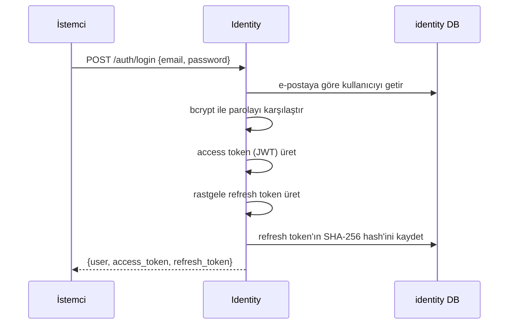

# 06 - Kimlik doğrulama akışı

## Kimlik doğrulama ve yetkilendirme

- **Authentication (kimlik doğrulama):** "Sen kimsin?" Giriş yaparak kanıtlarsın.
- **Authorization (yetkilendirme):** "Bunu yapmaya iznin var mı?" Rolün belirler.

## Sorun: HTTP durumsuzdur

Her istek bağımsızdır; sunucu önceki isteği hatırlamaz. Her istekte "ben giriş yapmış kullanıcıyım" demek için bir **token** gönderilir.

## İki token modeli

| | Access token | Refresh token |
| --- | --- | --- |
| Biçim | JWT (imzalı, içinde bilgi var) | Rastgele opak metin |
| Ömür | 15 dakika | 30 gün |
| Nerede kullanılır | Her API isteğinde `Authorization: Bearer ...` | Sadece `/auth/refresh` ve `/auth/logout` |
| Sunucuda saklanır mı | Hayır | Evet, **hash'i** `refresh_tokens` tablosunda |
| İptal edilebilir mi | Hayır, süresi dolana kadar geçerli | Evet |

**Neden iki tane?** Access token her istekte dolaştığı için çalınma riski yüksektir; bu yüzden ömrü kısadır. Ama kullanıcıyı 15 dakikada bir giriş yapmaya zorlamak kötü deneyim olur. Refresh token nadiren gönderilir, uzun yaşar ve sunucudan iptal edilebilir.

## JWT içinde ne var?

JWT üç parçadır: `başlık.içerik.imza`. İçerik (payload) herkes tarafından **okunabilir** (şifreli değil, sadece base64); imza ise değiştirilemez olmasını sağlar. Bu yüzden içine parola gibi sır **konmaz**. Rovena'da içerik:

```json
{ "iss": "rovena-identity", "sub": "<kullanıcı UUID>", "role": "customer", "iat": ..., "exp": ... }
```

İmza `JWT_SECRET` ile HS256 algoritmasıyla atılır. Secret'ı bilmeyen geçerli imza üretemez.

## Akışlar

### Kayıt ve giriş



Refresh token veritabanında **hash'li** tutulur. Veritabanı sızsa bile saldırgan ham token'ı elde edemez. Burada bcrypt yerine hızlı SHA-256 kullanılması bilinçlidir: token 256 bit rastgeledir, kaba kuvvetle bulunamaz; hızlı hash ise tabloda hash ile arama yapabilmemizi sağlar.

### Korumalı bir istek

1. İstemci `Authorization: Bearer <access token>` ile istek atar.
2. `auth.Middleware` imzayı, süreyi ve yayıncıyı doğrular. Geçersizse 401.
3. Geçerliyse kullanıcı bilgisi (`Claims`) isteğe eklenir; handler bunu okur.
4. Admin uçlarında ek olarak `RequireRole("admin")` çalışır; rol uymazsa 403.

Hiçbir veritabanı sorgusu gerekmez; doğrulama tamamen imzaya dayanır.

### Refresh (oturumu yenileme) ve rotasyon

Access token dolunca istemci `POST /auth/refresh` ile refresh token'ını sunar. Sunucu:

1. Token'ın hash'ini bulur. Yoksa reddeder.
2. Süresi dolmuşsa reddeder.
3. Token'ı **iptal eder** ve yeni bir access + refresh token çifti verir (rotasyon: her refresh token yalnızca bir kez kullanılabilir).

**Yeniden kullanım tespiti:** Zaten iptal edilmiş bir refresh token tekrar sunulursa, bu büyük olasılıkla token'ın çalındığı anlamına gelir (meşru kullanıcı ve saldırgan aynı token'ı kullanmaya çalışıyor). Sistem o kullanıcının **tüm** refresh token'larını iptal eder; herkes yeniden giriş yapar. Veritabanında bu, `UPDATE ... WHERE revoked_at IS NULL` ile atomik yapılır; iki eşzamanlı refresh isteğinden yalnızca biri kazanır.

### Logout

Refresh token'ı iptal eder. Access token 15 dakika daha geçerli kalır (JWT'nin bilinen kısıtı). İdempotenttir: bilinmeyen token için de başarılı döner.

## Rol değişikliğinin gecikmesi

Rol access token'ın içinde olduğu için, bir admin'in rolü düşürüldüğünde eski token'ı süresi dolana kadar (en fazla 15 dk) admin yetkisiyle çalışır. Bu bilinçli bir kısıt/denge; gerekirse access token süresi kısaltılabilir.

## Diğer servisler token'ı nasıl kullanacak?

Catalog gibi bir servis, `shared/auth` paketindeki `Middleware`'i kendi route'larına ekler ve **aynı `JWT_SECRET`** ile yapılandırılır:

```go
admin := router.Group("/admin", auth.Middleware(verifier), auth.RequireRole(auth.RoleAdmin))
```

Identity'ye istek atmaz. Kullanıcı id'sine `claims.UserID()` ile ulaşır. Bunun bir bedeli var: secret tüm servislerde paylaşılıyor. Daha güvenli çözüm asimetrik imza (RS256/EdDSA): Identity özel anahtarla imzalar, diğerleri sadece genel anahtarla doğrular. İleride yapılabilecek bir iyileştirmedir.

## Güvenlik önlemleri özeti

| Tehdit | Önlem |
| --- | --- |
| Parola çalınması | bcrypt hash, düz parola hiçbir yerde saklanmaz/loglanmaz |
| Kullanıcı sayımı (hangi e-posta kayıtlı) | Giriş hatası tek tip; sahte hash ile zamanlama eşitleme |
| Kaba kuvvet | `/auth/*` için dakikada 20 istek (IP başına), Nginx'te genel limit |
| Token çalınması | Kısa access ömrü, refresh rotasyonu, yeniden kullanım tespiti |
| Sahte token | İmza + süre + yayıncı + algoritma kontrolü (`alg: none` reddedilir) |
| Yetki yükseltme | Kayıt sadece `customer` verir; admin yalnızca seed veya mevcut admin ile |
| Veritabanı sızması | Refresh token'lar hash'li |
