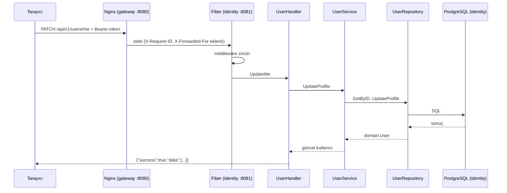

# 07 - Bir isteğin yolculuğu

Örnek: bir kullanıcı `PATCH /api/v1/users/me` ile adını değiştiriyor. İstek tarayıcıdan çıkıp veritabanına varana ve geri dönene kadar hangi dosyalardan geçer?

## Adım adım

1. **Nginx** (`infrastructure/nginx/nginx.conf`): Yol `/api/v1/users` ile eşleşir. Hız sınırı kontrol edilir, `X-Request-ID` eklenir, istek `identity:8081`'e iletilir.

2. **Fiber middleware zinciri** (`transport/http/router.go`), sırayla:
   - `RequestIDMiddleware`: kimlik numarasını al/üret.
   - `recover`: bir panik olursa sunucu çökmesin, 500 dönsün.
   - `AccessLog`: isteği ölçmeye başlar, bittiğinde tek satır log yazar.
   - `helmet`: güvenlik başlıkları ekler.
   - `cors`: tarayıcı çapraz-kaynak kurallarını uygular.

3. **Route grubu** `/users` için `auth.Middleware` çalışır (`shared/auth/middleware.go`): Bearer token'ı doğrular, `Claims`'i isteğe koyar. Token yoksa/bozuksa 401 ile burada biter.

4. **Handler** (`user_handler.go` → `UpdateMe`):
   - `currentUserID` ile token'dan kullanıcı id'sini alır. (Kullanıcı id'si **URL'den değil token'dan** gelir; başkasının profilini değiştirmek mümkün olmaz.)
   - `httpx.BindAndValidate` ile gövdeyi okur ve doğrular (ad en fazla 100 karakter vb.). Hatalıysa 422 ve alan bazlı mesajlar.
   - `UserService.UpdateProfile` çağrılır.

5. **Service** (`application/user_service.go`): Kullanıcıyı getirir, alanları kırpıp günceller, repository'ye yazdırır.

6. **Repository** (`repository/postgres/user_repository.go`): Parametreli `UPDATE users SET ... WHERE id = ?` çalıştırır. Satır yoksa `ErrUserNotFound` döner.

7. **Cevap:** Handler, domain `User`'ı `UserResponse` DTO'suna çevirir (parola hash'i yok) ve `response.OK` ile `{"success":true,"data":{...}}` yazar.

8. **Log:** `AccessLog` süreyi ve durum kodunu içeren satırı yazar:
   `{"msg":"http request","service":"identity","method":"PATCH","path":"/api/v1/users/me","status":200,"duration_ms":1,"request_id":"..."}`

## Hata yolu

Aynı istek, kullanıcı silinmişse:

`Repository` → `domain.ErrUserNotFound` → service aynen yukarı verir → handler `return err` → `httpx.NewErrorHandler` hatayı yakalar → `MapDomainError` (`transport/http/errors.go`) bunu 404 `AppError`'a çevirir → istemci `{"success":false,"message":"User not found"}` alır.

Veritabanı koptuysa: ham SQL hatası hiçbir mapper'a uymaz → 500 "Internal server error" döner, **gerçek hata loga** yazılır. İstemci iç ayrıntıyı görmez.

## Bu yolculuktan çıkan dersler

- Her katmanın tek bir işi var; bir hatayı bulmak için nerede olabileceğini katmandan tahmin edebilirsin.
- Hatalar yukarı doğru yayılır ve tek bir yerde HTTP'ye çevrilir.
- Aynı `request_id`, Nginx'ten servise ve loglara kadar taşınır. İleride birden fazla servis zincirinde bu kimlik, tek bir isteği tüm servislerde izlemeyi sağlayacak.
