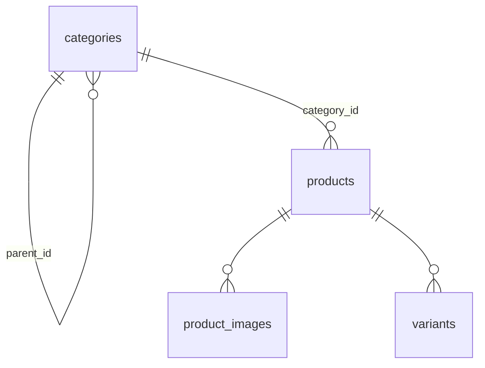

# 09 - Catalog servisi

Catalog, **vitrinde ne satıldığını** bilen servistir: kategoriler, ürünler, varyantlar (beden/renk), görseller, fiyatlar. Identity ile aynı katman düzenini kullanır ([05](05-identity-katmanlar.md)); bu bölüm yalnızca Catalog'a özgü fikirleri ve dosyaları anlatır.

## Servis sınırı: Catalog neyin sahibi, neyin değil?

| Catalog'un | Catalog'un DEĞİL |
| --- | --- |
| Ürün adı, açıklama, marka, kategori | **Stok miktarı** (Inventory'nin) |
| Varyantlar: SKU, beden, renk | Sepet ve sipariş (Order'ın) |
| Güncel satış fiyatı | Satın alındığı andaki fiyat (Order, sipariş anında kopyalar) |
| Görsel adresleri | Kullanıcılar (Identity'nin) |

"Bu üründen kaç tane var?" sorusunu Catalog **cevaplayamaz**; bu bilinçli bir sınırdır. İleride ürün sayfası hem Catalog'dan ürünü hem Inventory'den stok durumunu alıp birleştirecek.

Catalog, kullanıcıyı Identity'ye sormadan tanır: admin uçlarında `shared/auth` ile JWT'yi **kendisi doğrular** ([06](06-kimlik-dogrulama.md)). Aynı `JWT_SECRET` ile yapılandırılmıştır.

## Veri modeli



- **categories:** Ağaç yapısı (`parent_id`). Örn. Giyim → Dış Giyim, Tişört. Kategori oluşturulurken ebeveyni seçilir, sonradan değiştirilmez (döngü sorunu çıkmasın diye bilinçli sadeleştirme).
- **products:** `draft` (taslak), `active` (vitrinde), `archived` (gizli) durumları.
- **variants:** Satın alınan gerçek birim. Aynı gömleğin "M/Mavi" ve "L/Mavi" halleri ayrı varyanttır; her birinin **SKU**'su (stok kodu) ve fiyatı vardır. İleride Inventory stoğu ürün değil **varyant id**'sine bağlayacak, sepet de varyant tutacak.
- **product_images:** Sıralı görsel listesi (`position`).

### Kararlar ve nedenleri

- **Fiyat `price_cents` (int64):** Para kuruş cinsinden tamsayı tutulur (`459900` = 4.599,00 TL). Ondalıklı sayı (float) yuvarlama hataları yapar; para için asla kullanılmaz.
- **Silme yok, arşivleme var:** Ürün/varyant silinirse, onlara referans veren eski siparişler ve stok kayıtları anlamsızlaşır. `DELETE /admin/products/:id` ürünü arşivler. Varyant da silinmez, `active: false` yapılır.
- **Aktif ürünün en az bir aktif varyantı olmalı:** Satılamayan ürün vitrinde olamaz. Son aktif varyantın kapatılması ve varyantsız ürünün yayınlanması reddedilir (409). Bu kural aşağıdaki "Eşzamanlılık" bölümünde anlatıldığı gibi **veritabanı transaction'ında** uygulanır.
- **Slug:** URL'de kullanılan okunur ad (`deri-ceket`). Addan üretilir, Türkçe harfler sadeleşir (ç→c, ş→s...), çakışırsa `-2`, `-3` eklenir. Ürün yeniden adlandırılsa da slug **değişmez** (bağlantılar kırılmasın).
- **SKU:** Büyük harfe çevrilir, yalnızca harf/rakam/`-`/`_` kabul edilir, tüm sistemde tekil.
- **Veritabanı kısıtları son savunmadır:** Servis kontrol etse de iki eşzamanlı istek aynı slug/SKU'yu almaya çalışabilir. Bu yüzden tabloda `UNIQUE` kısıtları vardır; ihlal olursa repository bunu `ErrSlugTaken`/`ErrSKUTaken` gibi domain hatalarına çevirir (409). Aynı ürüne aynı beden+renk ikinci kez eklenemez (`variants_product_options_key` indeksi).

## Eşzamanlılık: iki admin aynı anda

Kural "aktif ürünün aktif varyantı olmalı" ilk yazımda serviste şöyle kontrol ediliyordu: aktif varyant sayısını oku, birden fazlaysa kapat. İki admin **aynı anda iki farklı varyantı** kapatırsa ikisi de "2 aktif var" görür, ikisi de kapatır ve ürün vitrinde varyantsız kalır. Bu klasik **check-then-act** (kontrol et, sonra işlem yap) yarış durumudur; tek kullanıcıyla test ederken asla görünmez.

Bunu gerçek Postgres'e karşı yazılmış bir entegrasyon testi yakaladı (iki goroutine'in aynı anda kapatması; düzeltmeden önce 2. turda 0 aktif varyant kaldı). Çözüm:

1. Kural repository'ye taşındı: varyant güncellemesi bir **transaction** içinde, önce ürün satırı `SELECT ... FOR UPDATE` ile **kilitlenir**, sonra "başka aktif varyant var mı" sayılır, sonra güncellenir.
2. Aynı ürüne dokunan iki işlem satır kilidi yüzünden **sırayla** çalışır; ikincisi birincinin sonucunu görür ve reddedilir.
3. Ürün durumunun `active` yapılması da aynı kilidi alır ve aktif varyant sayısını transaction içinde yeniden kontrol eder.

Ders: bir kuralın doğruluğu "iki işlemin araya girmesi"ne bağlıysa, kural uygulama kodunda değil **kilidin tutulduğu yerde** (veritabanı transaction'ı) uygulanmalıdır. Servis katmanı yalnızca hızlı ön kontrolleri yapar. (Inventory'de stok düşürürken aynı düşünce, `UPDATE ... WHERE stock >= n` gibi koşullu güncellemelerle karşımıza çıkacak.)

## Arama ve filtreleme

`GET /api/v1/products` parametreleri:

| Parametre | Anlamı |
| --- | --- |
| `q` | Ad/marka araması; kelimelerin **hepsi** geçmeli |
| `category` | Kategori slug'ı, **alt kategoriler dahil** (`giyim` → tişört, dış giyim de gelir) |
| `size`, `color` | Büyük/küçük harf duyarsız |
| `min_price`, `max_price` | Kuruş cinsinden; en az bir aktif varyantın fiyatı aralıkta olmalı |
| `sort` | `newest` (varsayılan), `price_asc`, `price_desc`, `name` |
| `page`, `page_size` | Varsayılan 1 ve 20, en fazla 100 |

Notlar:

- **`size` + `color` + fiyat aynı varyantı eşlemeli:** "M beden siyah" aramak, M bedeni olan **ve** siyah bir varyantı olan ürünleri değil, **M ve siyah olan bir varyantı** olan ürünleri getirir. SQL'de tek bir `EXISTS (SELECT ... FROM variants ...)` koşuluyla yapılır.
- **Kategori ağacı:** `WITH RECURSIVE` sorgusu seçilen kategorinin tüm torunlarını bulur.
- **Aksan duyarsız arama:** "canta" yazan kullanıcı "Çanta"yı bulmalı. Veritabanının `ILIKE`'ı bunu yapmaz. Çözüm: `products.search_text` sütununda ad+marka küçük harf ve sadeleştirilmiş halde (`deri omuz canta aurea`) tutulur; sorgudaki kelimeler de aynı fonksiyondan (`domain.SearchText`) geçirilir. Sütun üzerinde `pg_trgm` GIN indeksi vardır, böylece `LIKE '%kelime%'` büyük tabloda da hızlıdır. Bu sütun uygulama tarafından her kaydetmede güncellenir, API'de görünmez.
- **Joker karakter güvenliği:** Arama kelimeleri yalnızca `[a-z0-9]` bırakılarak üretildiği için kullanıcı `%` ya da `_` ile sorguyu manipüle edemez. Sıralama alanları da bir beyaz listeyle sınırlıdır (kullanıcıdan gelen sütun adı SQL'e asla girmez).
- **Listeleme "özet" döner:** Ad, slug, marka, başlangıç fiyatı (en ucuz aktif varyant), ilk görsel. Varyantlar yalnızca ürün detayında gelir; liste sayfası hafif kalır.
- **Önbellek:** Herkese açık okuma uçları `Cache-Control: public, max-age=60` döner; tarayıcı/proxy 1 dakika saklayabilir.

## API

Herkese açık (`/api/v1`):

| Metod | Yol | Not |
| --- | --- | --- |
| GET | `/categories` | Düz liste (`parent_id` ile ağaç istemcide kurulur) |
| GET | `/categories/:slug` | |
| GET | `/products` | Yukarıdaki filtreler; yalnızca **active** ürünler |
| GET | `/products/:idOrSlug` | UUID veya slug; yalnızca active, yalnızca **aktif varyantlar** |

Admin (`/api/v1/admin`, `Authorization: Bearer` + `admin` rolü):

| Metod | Yol | Not |
| --- | --- | --- |
| POST, PATCH, DELETE | `/categories`, `/categories/:id` | Ürünü ya da alt kategorisi olan kategori silinemez (409) |
| GET | `/products`, `/products/:id` | Tüm durumlar; `?status=draft` |
| POST | `/products` | İsteğe bağlı görseller ve ilk varyantlarla birlikte; varsayılan `draft` |
| PATCH | `/products/:id` | Kısmi güncelleme; `images` gönderilirse liste tamamen değiştirilir |
| DELETE | `/products/:id` | Arşivler (204) |
| POST | `/products/:id/variants` | |
| PATCH | `/products/:id/variants/:variantId` | Beden, renk, fiyat, `active`. SKU değiştirilemez |

Public ve admin ayrı yol önekleriyle (`/admin`) ayrıldı. Böylece yetki kuralı tek bir route grubunda görünür, gateway ve ileride frontend için de net bir sınır olur.

Girdi doğrulamasında görsel adresleri yalnızca `http(s)` olabilir (`javascript:` gibi şemalar reddedilir). Hatalı alanlar `images[1].url` gibi tam yolla bildirilir.

## Dosya haritası

```text
services/catalog/
├── cmd/{api,migrate,seed}/main.go
├── internal/
│   ├── domain/
│   │   ├── catalog.go          Category, Product, Variant, Image, durumlar, filtre, hatalar
│   │   ├── slug.go             Slugify ve SearchText (saf fonksiyonlar, testli)
│   ├── application/
│   │   ├── category_service.go
│   │   ├── product_service.go  Yayınlama/arşivleme/varyant kuralları
│   │   └── slug.go             Çakışmayan slug üretimi
│   ├── repository/
│   │   ├── repository.go       Arayüzler: Category/Product/VariantRepository
│   │   └── postgres/           models.go, errors.go, *_repository.go
│   ├── transport/http/         router.go, dto.go, *_handler.go, errors.go
│   └── infrastructure/         config/, database/
└── migrations/                 00001 (tablolar), 00002 (search_text)
```

Identity'den farklar:

- `product_repository.go` en karmaşık dosyadır: dinamik filtreleri tek sorguya çevirir, sayfayı ve toplam sayıyı birlikte alır, küçük görselleri toplu bir sorguyla ekler (her ürün için ayrı sorgu atmamak için).
- **Transaction:** Ürün oluşturma ürün + görseller + varyantları **tek transaction**'da yazar. Biri başarısız olursa hiçbiri kaydedilmez (`RunInTx`). Bu, tek servisin kendi veritabanı içindeki transaction'dır; servisler arası olsaydı Saga gerekirdi ([01](01-mikroservis-nedir.md)).
- `errors.go` (postgres): PostgreSQL hata kodlarını (`23505` benzersizlik, `23503` yabancı anahtar) ve kısıt adlarını domain hatalarına çevirir.
- `cmd/seed`: Demo veri (5 kategori, 3 aktif + 1 taslak ürün). Servis katmanını kullanır, böylece slug üretimi gibi kurallar seed'de de çalışır.

## Performans: ölçerek karar verildi

Bu kod bir incelemeden geçti; bazı "yavaş olur" iddiaları **20 bin ürün / 84 bin varyantlık sentetik veriyle ölçülerek** denendi (veri bir transaction içinde üretilip `ROLLBACK` edildi, `EXPLAIN ANALYZE` ile):

| Sorgu | Sonuç | Karar |
| --- | --- | --- |
| Fiyata göre sıralama (her ürün için `MIN(fiyat)` alt sorgusu) | 235 ms | Kısmi indeks eklendi: **36 ms**. `00003` migration'ı |
| Aynı sorgu, `min_price` kolonu ürün tablosunda tutulsaydı | 5 ms | Şimdilik yapılmadı (aşağıya bak) |
| Yalnızca renk filtresi (`EXISTS`) | Plan `product_id = p.id AND lower(color) = ...` ile mevcut indeksi **kullanıyor** | Değişiklik gerekmedi |
| Kategori ağacı `WITH RECURSIVE` (200 kategori) | CTE 0,15 ms | Önbelleğe gerek yok |
| Sayfalama `COUNT(*)` | 2,8 ms | Şimdilik sorun yok |

Eklenen indeks: `variants (product_id, price_cents) WHERE active`. Alt sorgu her ürün için tek bir **index-only scan** yapar; eskiden her ürünün tüm varyant satırlarını okuyordu.

**Neden `min_price` kolonu yok?** 5 ms'ye karşılık her varyant değişikliğinde (fiyat, aktif/pasif, ekleme) ürün tablosundaki kopyanın da güncellenmesi gerekir; bir yerde unutulursa vitrinde yanlış fiyat gösterilir. 20 bin üründe 36 ms kabul edilebilir. Katalog yüz binlere çıkarsa tekrar ölçüp bu denormalizasyon yapılabilir (varyant değişiklikleri zaten tek bir transaction yolundan geçtiği için bakım yeri belli).

**Genel ders:** "Bu yavaş olur" tahmini, `EXPLAIN ANALYZE` çıktısı olmadan güvenilir değildir. Planlayıcı sandığımızdan farklı davranabilir (renk filtresi örneği). Önce ölç, sonra optimize et.

## Test

Catalog'da üç farklı test katmanı var; her biri farklı bir riski yakalar:

| Katman | Dosya | Veritabanı | Neyi yakalar |
| --- | --- | --- | --- |
| Birim (iş kuralı) | `application/service_test.go`, `domain/slug_test.go` | Yok (sahte repository) | Slug çakışması, taslak varsayılanı, yayın kuralı, taslak/arşivin gizliliği, Türkçe slug ve arama metni |
| HTTP | `transport/http/http_test.go` (+ `fakes_test.go`) | Yok (bellek içi repository) | Yetkilendirme matrisi, girdi doğrulama, hata eşleme, cache, CORS, request id, body limiti |
| Entegrasyon | `repository/postgres/*_integration_test.go` | **Gerçek Postgres** | Arama/filtre SQL'i, kilit ve eşzamanlılık, transaction |

### HTTP testleri nasıl çalışır?

Gerçek Fiber uygulaması (`transport.NewApp`) ve gerçek servisler kurulur; yalnızca repository'ler bellek içi sahtelerle değiştirilir. İstekler `app.Test` ile ağ olmadan gönderilir, yani router, middleware sırası, JWT doğrulama, JSON doğrulama ve hata eşleme **birlikte** test edilir. Testler yaklaşık 0,3 saniyede biter.

- **Yetkilendirme matrisi:** 10 admin yolu x 8 kimlik durumu (başlıksız, yanlış şema, boş bearer, bozuk token, yanlış imza, süresi dolmuş, customer, admin). Yeni bir admin yolu eklenirse buraya da eklenmelidir; unutulursa güvenlik açığı sessizce kalır.
- **Girdi doğrulama:** 14 senaryo (kısa ad, geçersiz UUID, `javascript:` görsel adresi, 11 görsel, sıfır/negatif fiyat, fiyatı string gönderme, bozuk JSON...). Hatalı istek asla ürün oluşturmaz.
- **Sorgu parametreleri:** Sınırların kırpılması (`page_size=100000` → 100), geçersiz `sort`/fiyat reddi ve **reddedilen isteğin repository'ye hiç ulaşmaması**.
- **Bilgi sızıntısı:** Beklenmeyen bir hata (ör. bağlantı dizesi içeren) istemciye yalnızca "Internal server error" olarak gider; `/readyz` bağımlılık hatasının ayrıntısını göstermez.
- **Body limiti** gerçek bir TCP soketiyle denenir: `app.Test` ağ katmanını atladığı için limit orada çalışmaz. Test aracının sınırını bilmek de testin parçasıdır.

### Entegrasyon testleri

Çalıştırma: `make up` sonrası `make test-integration` (`integration` build etiketi sayesinde `make test` bunları atlar). Her test kendi rastgele adlı kategorisini ve ürünlerini oluşturur, bitince siler; demo veriyle karışmaz.

`search_integration_test.go` beş ürünlük bir fikstür kurar (aktif, taslak, pasif varyantlı, alt kategorideki...) ve şunları doğrular: aksan ve büyük/küçük harf duyarsız arama, tüm kelimelerin eşleşmesi, `%`/`_`/SQL enjeksiyonu denemelerinin zararsızlığı, alt kategorileri kapsayan kategori filtresi, **beden+renk+fiyatın aynı varyantta eşleşmesi**, pasif varyantın fiyat ve filtreye katılmaması, tüm sıralamalar, sayfalama (son sayfadan sonrası boş ama toplam doğru), durum filtresi, özet alanları (başlangıç fiyatı, ilk görsel), görsellerin değiştirilmesi ve yeniden adlandırmada arama sütununun yenilenmesi.

### Testlerin testi: mutasyon

"Hepsi geçti" tek başına bir şey kanıtlamaz; test hiçbir şeyi doğrulamıyor da olabilir. Bu yüzden kod **bilerek bozuldu** ve testlerin kırmızıya dönüp dönmediğine bakıldı:

| Bilerek bozulan | Yakalayan test |
| --- | --- |
| Varyant filtreleri `active` koşulunu yok sayıyor | `price_range` |
| Kategori filtresi alt kategorileri kapsamıyor | `category_includes_descendants` ve 7 test daha |
| Başlangıç fiyatı pasif varyantı da sayıyor | `sorting`, `pagination`, `summary_data` |
| Arama yalnızca ilk kelimeyi kullanıyor | `text_query` |
| Güncellemede `search_text` yenilenmiyor | `TestGetAndUpdateImages` |
| Admin grubunda rol kontrolü yok | `TestAdminRoutes_Authorization` |
| Admin grubunda kimlik doğrulama yok | 4 test |
| Liste yanıtında cache başlığı yok | `TestCacheHeaders` |
| Herkese açık liste `active` filtresini uygulamıyor | 3 test |
| Görsellerde `dive` doğrulaması yok | `TestCreateProduct_Validation` |
| SKU çakışması 409 yerine 500 dönüyor | `TestDomainErrorsMapToHTTP` |
| 5xx yanıtta ham hata gösteriliyor | `TestUnexpectedErrorsDoNotLeakDetails` |
| Süresi dolmuş token kabul ediliyor | `TestAdminRoutes_Authorization` |

Hepsi yakalandı. Bu işlem otomatik bir araçla değil elle yapıldı; ileride CI'da bir mutasyon aracı (ör. `go-mutesting`) düşünülebilir.

## Sonraki adımlarla bağlantı

- **Inventory** varyant id'sini kullanarak stok tutacak. Yeni bir varyant eklendiğinde Inventory'nin bundan haberdar olması için Catalog bir olay (`VariantCreated`) yayınlayacak. Bu, Transactional Outbox'ın ilk gerçek kullanım yeri olabilir.
- **Order** sipariş anında ürün adı, varyant ve fiyatı kendi tablosuna **kopyalar**; sonradan Catalog'da fiyat değişse de eski sipariş değişmez.
