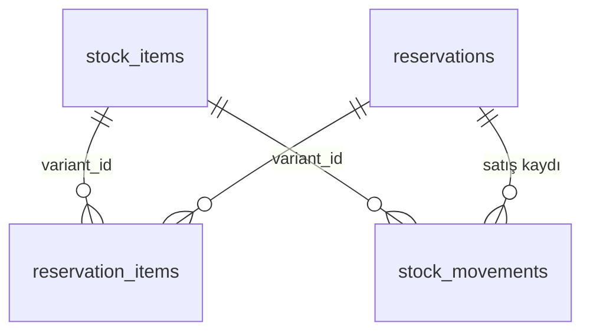
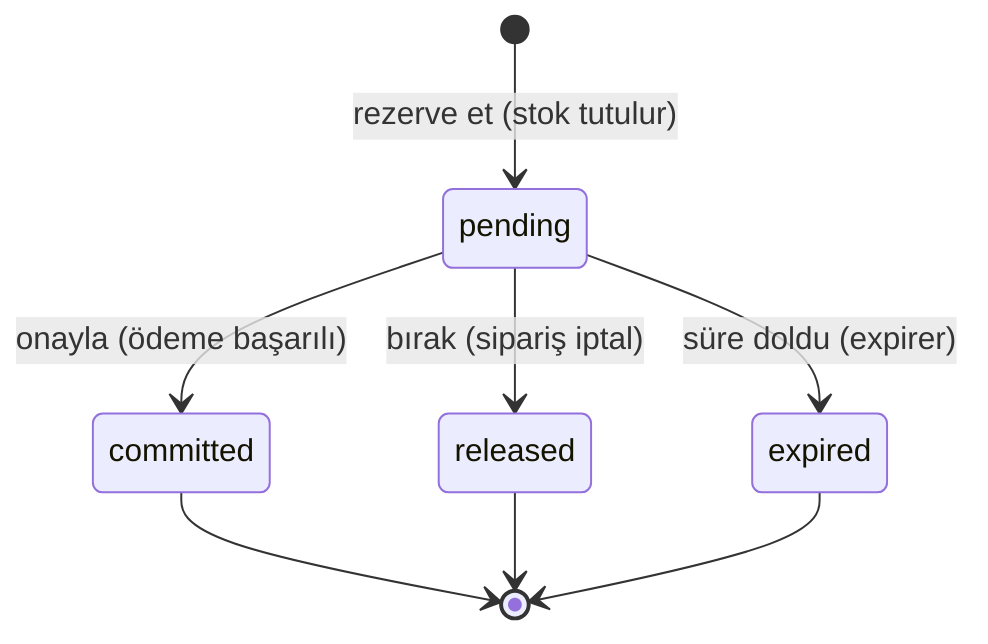

# 10 - Inventory servisi

Inventory, **bir şeyden kaç tane satılabilir** sorusunun tek yetkili cevabıdır: stok sayıları, rezervasyonlar ve stok hareketleri. Katman düzeni Identity ve Catalog ile aynıdır ([05](05-identity-katmanlar.md)); bu bölüm Inventory'ye özgü kararları anlatır.

Servisin tek bir varlık nedeni var: **overselling** (elde olmayanı satmak). Aşağıdaki her karar bu riske karşı alınmıştır.

## Servis sınırı

| Inventory'nin | Inventory'nin DEĞİL |
| --- | --- |
| Varyant başına eldeki miktar | Ürün adı, açıklama, fiyat (Catalog'un) |
| Rezervasyonlar ve süreleri | Sipariş, sepet, ödeme (Order/Payment'ın) |
| Stok hareket defteri (giriş/düzeltme/satış) | Hangi müşterinin sipariş verdiği |

Inventory, Catalog'un veritabanını **okumaz**. Bir varyantı `variant_id` ve `sku` kopyasıyla tanır; bu alanlar başka serviste olduğu için veritabanı seviyesinde foreign key yoktur. "Bu varyant gerçekten var mı" sorusunu Inventory doğrulayamaz — bilinçli bir sınır. Demo stoklarını yükleyen `cmd/seed`, tam bu yüzden Catalog'un **herkese açık API'sinden** varyantları okur (`CATALOG_BASE_URL`), veritabanından değil.

## İki sayı: `on_hand` ve `reserved`

```text
on_hand   = depodaki fiziksel adet
reserved  = bunun, siparişlere söz verilmiş kısmı
available = on_hand - reserved     (yeni bir siparişin alabileceği)
```

Tek sayıyla (`available`) çalışmak cazip ama yanlış olurdu: ödeme aşamasındaki bir sipariş için stok **ayrılmış** olmalı ama mal henüz depodan çıkmamıştır. İki sayı bu iki durumu ayırır:

| Olay | `on_hand` | `reserved` |
| --- | --- | --- |
| Depoya mal girişi | +n | — |
| Rezervasyon (ödeme bekleniyor) | — | +n |
| Rezervasyon onayı (satış gerçekleşti) | −n | −n |
| Rezervasyon iptali / süre aşımı | — | −n |
| Sayım düzeltmesi, hasar | ±n | — |

Veritabanı bu ilişkiyi kısıtlarla **garanti eder**: `on_hand >= 0`, `reserved >= 0` ve `reserved <= on_hand`. Kodda bir hata olsa bile, söz verilenden fazlası satılamaz.

## Veri modeli



- **stock_items:** Varyant başına tek satır (`variant_id` ve `sku` tekil).
- **reservations:** Sipariş başına tek rezervasyon (`order_id` **UNIQUE** — aşağıda "Idempotency").
- **reservation_items:** Rezervasyonun satırları (varyant + adet).
- **stock_movements:** Yalnızca **`on_hand` değişimlerinin** eklenir-silinmez defteri: `receipt` (giriş), `adjustment` (düzeltme), `sale` (satış). Rezervasyon alıp bırakmak deftere yazılmaz; çünkü mal depoya girmemiş/çıkmamıştır, sadece "söz verilmiş" durumu değişmiştir. Her satış hareketi hangi rezervasyondan geldiğini tutar.

## Rezervasyonun yaşam döngüsü



- `committed` **nihaidir**: onaylanmış rezervasyon bırakılamaz (409).
- `released`/`expired` olan rezervasyon onaylanamaz (409).
- Aynı işlemi tekrar yapmak hata değildir: onayı iki kez istemek ikinci kez stok düşürmez, bırakmayı üç kez istemek stoğu üç kez geri vermez. Bu, [Saga](99-sozluk.md) içinde aynı mesajın birden fazla gelebilmesi için zorunludur.
- `expired` ile `released` aynı işi yapar; ayrı tutulur çünkü biri "sipariş iptal edildi", öteki "müşteri kayboldu" demektir ve bu ayrım operasyonel olarak değerlidir.

### Süre aşımı neden var?

Ödeme sayfasında vazgeçen bir müşteri, stoğu sonsuza kadar kimseye bırakmazdı. Her rezervasyonun `expires_at` değeri vardır (`RESERVATION_TTL`, varsayılan 15 dakika) ve `application/expirer.go` içindeki arka plan döngüsü süresi geçenleri serbest bırakır (varsayılan dakikada bir, `reservations_due_idx` kısmi indeksiyle).

Süpürme **servis açılışında bir kez de** çalışır: servis kapalıyken süresi dolan rezervasyonlar ilk tikte değil, hemen geri verilir. Hata olursa sonraki tikte yeniden denenir; rezervasyon "süresi geçmiş" kalmaya devam ettiği için iş kaybolmaz.

## Overselling'e karşı: koşullu güncelleme

Kritik kod tek bir SQL cümlesidir (`repository/postgres/reservation_repository.go`, `hold`):

```sql
UPDATE stock_items
   SET reserved = reserved + :adet
 WHERE variant_id = :varyant
   AND on_hand - reserved >= :adet     -- kontrol, güncellemenin kendisinde
```

Hiç satır etkilenmediyse stok yetmemiştir. Bunun neden "önce oku, yeterliyse güncelle"den (**check-then-act**) üstün olduğu [09](09-catalog-servisi.md)'da da anlatılan derstir: okuma ile yazma arasında başka bir sipariş araya girebilir. Kontrol `WHERE` içinde olduğunda, veritabanı satırı güncellerken kilitler ve ikinci işlem **birincinin sonucunu görerek** eşleşmez.

Üç ek karar:

1. **Hep ya hiç:** Rezervasyon satırı ve tüm kalemler tek transaction içindedir. İkinci kalemde stok yetmezse birincinin tuttuğu adet de geri alınır; yarım rezervasyon diye bir şey yoktur.
2. **Sabit kilit sırası:** Kalemler `variant_id`'ye göre sıralanır (`application/reservation_service.go`). İki sipariş aynı iki varyantı ters sırada isterse, sıralama olmadan birbirlerini **deadlock**'a sokabilirler (ikisi de ötekinin kilidini bekler). Sıralama bunu imkânsız kılar.
3. **Satır kilidi (`FOR UPDATE`):** Onay/bırakma/süre aşımı işlemleri rezervasyon satırını kilitleyerek başlar; böylece "durumu oku, sonra duruma göre davran" adımı serileşir.

Stoğu azaltan admin düzeltmesi de aynı mantıkla koşulludur: `on_hand + delta >= reserved` sağlanmazsa düzeltme reddedilir (409). Siparişlere söz verilmiş mal, sayım düzeltmesiyle buharlaştırılamaz.

## Idempotency: `order_id` tekilliği

`reservations.order_id` üzerinde UNIQUE kısıt vardır ve rezervasyon isteği **önce bu satırı ekler**, stoğa sonra dokunur. Aynı sipariş için gelen tekrar isteği kısıta çarpar, transaction geri alınır (yani stok iki kez tutulmaz) ve servis var olan rezervasyonu döner:

- Yeni rezervasyon → **201 Created**
- Var olanın tekrarı → **200 OK**, aynı rezervasyon

Order servisi mesajı iki kez işlese, ya da ağ hatasından sonra isteği yeniden gönderse, sonuç aynı kalır. Bu davranış `TestConcurrentReserveOfSameOrderHoldsStockOnce` testiyle gerçek Postgres'e karşı doğrulanır: altı eşzamanlı istek, bir rezervasyon, bir kez tutulmuş stok.

## API

Üç ayrı kitleye üç ayrı yol öneki ve üç ayrı yetki kuralı:

**Herkese açık** (`/api/v1`) — vitrin:

| Metod | Yol | Not |
| --- | --- | --- |
| GET | `/stock?variant_ids=a,b,c` | En fazla 100 varyant; her varyant için `{available, in_stock}` |

Cevap `on_hand`/`reserved` içermez: müşteriyi ilgilendiren "alabilir miyim", depo içi ayrım değil. `Cache-Control: no-store` döner — bir dakika önbelleklenen stok bilgisi, olmayan malı satmaya davettir (Catalog'da önbellek vardı, burada bilinçle yok).

**Servisler arası** (`/api/v1/internal`, `X-Internal-Key` başlığı) — Order servisi:

| Metod | Yol | Not |
| --- | --- | --- |
| POST | `/reservations` | `{order_id, items[]}` → 201 yeni, 200 tekrar |
| GET | `/reservations/:id`, `/reservations/by-order/:orderId` | |
| POST | `/reservations/:id/commit` | Satışa dönüştürür (idempotent) |
| POST | `/reservations/:id/release` | Telafi işlemi: stoğu geri verir (idempotent) |

Bu uçları çağıran bir **kullanıcı** yoktur, dolayısıyla doğrulanacak bir JWT de yoktur. İki katmanlı korunurlar: Nginx bu yolu **hiç yönlendirmez** (yani internetten erişilemez) ve servis `INTERNAL_API_KEY` ile gelen anahtarı sabit zamanlı karşılaştırır. Admin token'ı bu uçlar için geçerli değildir; test bunu açıkça doğrular.

**Admin** (`/api/v1/admin`, `Bearer` + `admin` rolü) — depo yönetimi:

| Metod | Yol | Not |
| --- | --- | --- |
| GET | `/stock` | `sku` ön eki, `below=5` (kritik stok), `sort=newest\|sku\|available_asc`, sayfalama |
| POST | `/stock` | Varyantı takibe alır (`variant_id`, `sku`, `on_hand`) |
| GET | `/stock/:variantId` | `on_hand`, `reserved`, `available` |
| POST | `/stock/:variantId/receipts` | Mal girişi (`quantity > 0`) |
| POST | `/stock/:variantId/adjustments` | Düzeltme (`delta`, **`reason` zorunlu**) |
| GET | `/stock/:variantId/movements` | Hareket defteri |

Düzeltmede sebep zorunludur: defterin amacı, bir sayının neden değiştiğini sonradan açıklayabilmek. Stok kaydı **silinemez** — sipariş geçmişi ve defter ona referans verir (Catalog'daki "silme yok, arşivleme var" kararının aynısı).

Stok yetmediğinde cevap hangi varyantta kaç adet eksik olduğunu alan bazlı söyler:

```json
{ "message": "Insufficient stock",
  "fields": { "variant_id": "...", "requested": "5", "available": "2" } }
```

Order servisi bunu müşteriye "bu ürün için yalnızca 2 adet kaldı" diye çevirebilir.

## Testler

| Katman | Dosya | Veritabanı | Neyi yakalar |
| --- | --- | --- | --- |
| Birim | `application/service_test.go` | Yok (bellek içi sahte) | Yaşam döngüsü kuralları, idempotentlik, doğrulama, hep-ya-hiç, expirer, kritik stok filtresi |
| HTTP | `transport/http/http_test.go` | Yok | Üç yetki kuralı (public / internal key / admin JWT), girdi doğrulama, hata eşleme, 201-vs-200, `no-store`, sağlık uçları |
| Entegrasyon | `repository/postgres/integration_test.go` | **Gerçek Postgres** | Koşullu güncelleme, kilitler, transaction geri alma, deadlock'suzluk, süpürme |

Sahte repository'ler veritabanının kurallarını (koşullu tutma, sipariş başına tek rezervasyon, hep-ya-hiç) taklit eder; yoksa birim testler gerçekte olmayan bir dünyayı test etmiş olurdu.

Entegrasyon testlerinin en önemlileri eşzamanlılıkla ilgili:

- **`TestConcurrentReservationsDoNotOversell`:** Tek adet stok, sekiz eşzamanlı sipariş → tam olarak biri kazanır, yedisi "yetersiz stok" alır, `reserved` 1'de kalır.
- **`TestConcurrentReserveOfSameOrderHoldsStockOnce`:** Aynı `order_id` ile altı eşzamanlı istek → tek rezervasyon, tek tutma.
- **`TestOppositeItemOrderDoesNotDeadlock`:** Aynı iki varyantı ters sırada isteyen 30 rezervasyon → hiçbiri deadlock'a girmez.
- **`TestMultiItemReserveRollsBackCompletely`:** İkinci kalem yetmezse ne stok tutulur ne rezervasyon satırı kalır.
- **`TestAdjustCannotEatIntoReservedStock`**, **`TestExpireDueReleasesAbandonedHolds`**, **`TestReleaseIsIdempotent`**.
- **`TestCommitAndReleaseRefuseEachOthersReservations`:** Ödenmiş (commit) bir rezervasyon release edilemez, bırakılmış bir rezervasyon commit edilemez, ikinci commit ikinci satış yazmaz (hareket defterinde tam bir `sale` satırı).
- **`TestExpireDueBatchOnlyContainsPendingReservations`:** Süpürücü işi 200'lük gruplarla alır. Kapanmış (ör. ödenmiş) bir rezervasyon gruptan yer kaplarsa, vadesi geçmiş gerçek rezervasyonlar sırası gelmeden açlıktan kalabilir.

HTTP katmanına ayrıca `security_test.go` eklendi: dahili anahtarın benzerleri (bir karakter eksik/fazla, büyük harf, anahtarın içine boşluk, başka başlık adı, sorgu/çerez/gövde, `Bearer` olarak) reddedilir; anahtar admin uçlarını açmaz; `alg: none` token reddedilir; **loglar anahtarı ve token'ları içermez**; CORS dahili anahtar başlığına izin vermez; bilinmeyen yol/metot standart hata zarfıyla döner; 64 KB gövde sınırı (gerçek soketle); bozuk/yanlış tipli gövdeler iş yapılmadan reddedilir.

### Testlerin testi: mutasyon

Catalog'da olduğu gibi kod bilerek bozulup testlerin kırmızıya döndüğü kontrol edildi:

| Bilerek bozulan | Sonuç |
| --- | --- |
| `hold` içindeki `on_hand - reserved >= ?` koşulu kaldırıldı | **Yakalandı** — oversell testi düştü; veritabanı CHECK'i devreye girdi, yani son savunma da çalışıyor |
| Kalemlerin `variant_id` sıralaması kaldırıldı | **Yakalandı** — deadlock testi düştü (30 rezervasyondan yalnızca 4'ü tamamlandı) |
| `order_id` çakışmasının idempotent ele alınması kaldırıldı | **Yakalandı** — eşzamanlı tekrar testi "duplicate key" hatasıyla düştü |
| `FOR UPDATE` kaldırıldı | **Yakalanmadı** (aşağıya bakın) |

Bu ilk turdan sonra testlerin kendisi de ikinci bir mutasyon turundan geçirildi (HTTP/güvenlik katmanı ve repository). İki **gerçek boşluk** bulundu ve kapatıldı:

| Bilerek bozulan | İlk sonuç | Düzeltme |
| --- | --- | --- |
| Release, commit edilmiş rezervasyonu da bırakabiliyor | Gerçek repository'de **yakalanmadı** (kural yalnızca sahte repository'ye karşı test ediliyordu) | `TestCommitAndReleaseRefuseEachOthersReservations` |
| Süpürücü `pending` olmayanları da seçiyor | **Yakalanmadı**: sonuç aynı görünüyor, ama batch'i kapanmış kayıtlar doldurabilir | `TestExpireDueBatchOnlyContainsPendingReservations` |
| `adjust` içindeki `on_hand + ? >= reserved` koşulu kaldırıldı | Yakalanmadı, **bilerek**: veritabanındaki `CHECK` aynı hatayı üretiyor (eşdeğer mutasyon). Koşul bir kemer, `CHECK` bir askı | yok |

Dahili anahtar, CORS, rol/anahtar kontrolü, log sızıntısı ve gövde sınırı mutasyonlarının (7 adet) hepsi ilk seferde yakalandı.

Birinci turdaki son satır dürüstçe not edilmeye değer. `FOR UPDATE` olmadan da sonuç yanlış çıkmıyor, çünkü Postgres `UPDATE` sırasında satırı zaten kilitler ve CHECK kısıtları imkânsız bir sonucu engelliyor. Fark **hatanın kalitesinde**: iki transaction gerçekten çakıştığında, kilidi olmayan sürümde kaybeden taraf temiz bir 409 yerine ham bir CHECK ihlali (yani istemciye 500) alıyor. Bu, onay ile bırakma arasına yapay 60 ms gecikme konularak **kanıtlandı**: gecikmeyle birlikte mutasyon testi düşürüyor, `FOR UPDATE` geri konduğunda aynı gecikmeyle geçiyor.

Bu deneyden iki sonuç çıktı:

1. Yarış testlerinin geçmesi, yarışın gerçekten yaşandığını göstermez (aynı ders [08](08-calistirma-ve-test.md)'de Identity için de çıkmıştı). İki goroutine "aynı anda" başlasa bile transaction'lar birbirine yetişmeyebilir.
2. Yine de böyle bir çakışmanın istemciye 500 olarak gitmemesi gerekir. Bu yüzden `reserved`/`on_hand` CHECK ihlalleri `domain.ErrStockConflict` hatasına, oradan da "Stock changed concurrently, please retry" (409) cevabına eşlenir.

## Order servisiyle bağlantı (sıradaki adım)

Checkout akışında Inventory'nin rolü hazır: Order rezervasyon alır, ödeme sonucuna göre `commit` ya da `release` çağırır.

**Karar: hibrit Saga.** Bu uçlar REST olarak kalıyor; Inventory'ye RabbitMQ tüketicisi eklenmeyecek. Gerekçe: rezervasyonun sonucu (alındı ya da hangi kalem yetmiyor) Order'ın **hemen** bilmesi gereken bir cevaptır, bu bir istek/cevap işidir. Olay tabanlı olsaydı Order cevabı beklemek için ayrı bir durum makinesi tutmak zorunda kalırdı. Asenkron kısım ödemedir (yavaş, yeniden denenebilir): onun için RabbitMQ ve Transactional Outbox kullanılacak. `docs/architecture.md` bölüm 7 bu kararı ve akışı gösterir.

Idempotentlik ve telafi (release) kuralları buna uygun tasarlandı: Order bir çağrıyı zaman aşımından sonra güvenle tekrar edebilir (aynı `order_id` aynı rezervasyonu döner, commit/release tekrarı stoğu ikinci kez oynatmaz). Order çökerse de Inventory'nin süpürücüsü rezervasyonu süresi dolunca kendisi bırakır; stok sonsuza kadar kilitli kalmaz.

## Dosya haritası

```text
services/inventory/
├── cmd/
│   ├── api/main.go             Sunucu + arka plan expirer döngüsü
│   ├── migrate/main.go
│   └── seed/main.go            Catalog'un public API'sinden varyantları okur, açılış stoğu yazar
├── internal/
│   ├── domain/inventory.go     StockItem, Reservation, Movement, durumlar, hatalar, StockError
│   ├── application/
│   │   ├── stock_service.go        Takibe alma, giriş, düzeltme, listeleme, uygunluk
│   │   ├── reservation_service.go  Doğrulama, sabit kilit sırası, TTL
│   │   └── expirer.go              Süresi geçen rezervasyonları süpüren döngü
│   ├── repository/
│   │   ├── repository.go           Arayüzler: Stock/ReservationRepository
│   │   └── postgres/               models.go, errors.go, stock_repository.go,
│   │                               reservation_repository.go (koşullu güncelleme + kilitler)
│   ├── transport/http/         router.go, dto.go, *_handler.go, errors.go, internal_auth.go
│   └── infrastructure/         config/, database/
└── migrations/00001_create_inventory.sql
```
