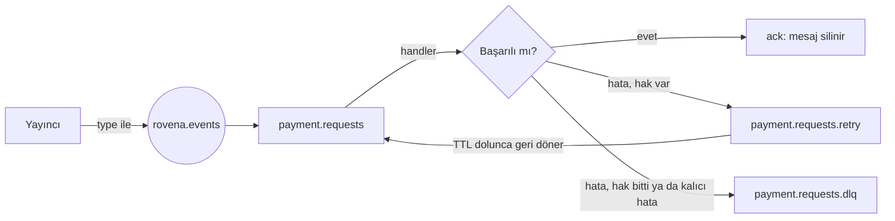
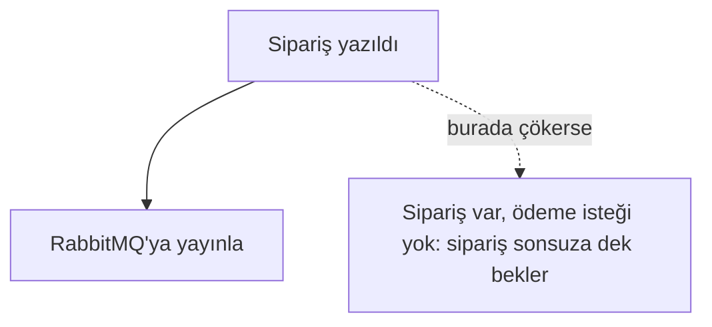
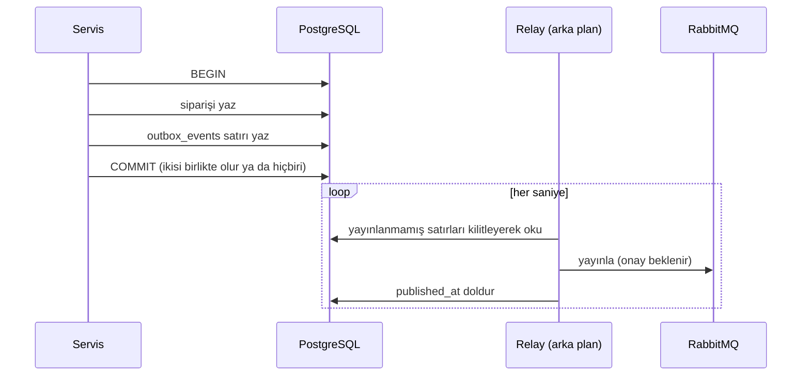

# 12 - Mesajlaşma: olaylar, Outbox ve idempotent tüketici

Şimdiye kadar servisler birbirine yalnızca REST ile konuştu. Ödeme gibi yavaş, hata verebilen ve tekrar denenmesi gereken işler için bu yetmez: **RabbitMQ** üzerinden asenkron mesajlaşma gerekir. Bu bölüm, Order ve Payment servislerinin üzerine kurulacağı altyapıyı anlatır. Kod `shared/messaging` ve `shared/outbox` paketlerindedir; Payment ([13](13-payment-servisi.md)) ve Order ([14](14-order-servisi-ve-saga.md)) kullanıyor.

Mesajlaşmayı güvenilir yapan üç parça var ve her biri ayrı bir riske karşı:

| Risk | Çözüm | Paket |
| --- | --- | --- |
| Veritabanına yazdım ama olayı yayınlayamadan çöktüm (ya da tersi) | Transactional Outbox | `outbox` |
| Aynı olay iki kez teslim edildi | Idempotent tüketici (Inbox) | `outbox` |
| Bir mesaj işlenemiyor, kuyruğu tıkıyor | Retry kuyruğu ve DLQ | `messaging` |

## Olay zarfı (Envelope)

Her olay aynı zarfın içinde taşınır. Tüketici, içeriği (payload) bilmeden de zarfa bakıp olayı tanıyabilir.

```json
{
  "event_id": "0197...",
  "type": "PaymentRequested",
  "version": 1,
  "occurred_at": "2026-10-10T15:40:00Z",
  "correlation_id": "b3c1...",
  "request_id": "8f2a...",
  "payload": { "order_id": "...", "amount": 4200 }
}
```

| Alan | Ne işe yarar |
| --- | --- |
| `event_id` | Olayın kimliği. **Tekrar teslimatta aynı kalır**; tüketici tekrarı bununla tanır |
| `type` | Olayın adı; aynı zamanda RabbitMQ'daki yönlendirme anahtarı |
| `version` | Payload şeması değişince tüketici hangi biçimi okuduğunu bilir |
| `correlation_id` | Tek bir iş akışının (bir checkout) tüm olaylarını birbirine bağlar |
| `request_id` | O akışı başlatan HTTP isteğinin `X-Request-ID`'si; logda API'den asenkron kısma geçişi sağlar |

`correlation_id` ve `request_id`, Go'nun `context`'i içinde taşınır (`messaging.WithCorrelationID`). Bir handler olay aldığında kendisine verilen `ctx` zaten o olayın kimliklerini taşır; handler tepki olarak yeni bir olay yayınlarsa o olay otomatik olarak aynı akışta kalır.

**Olay mı komut mu?** Olay "oldu" der (`PaymentSucceeded`), komut "yap" der (`PaymentRequested`). İkisi aynı zarfı kullanır ama anlamları karıştırılmaz: olayın tüketicisini yayıncı bilmez, komutun muhatabı bellidir.

## RabbitMQ topolojisi

Tek bir **topic exchange** var: `rovena.events`. Yayıncı olayı bu exchange'e olay tipiyle gönderir. Her tüketici kendi kuyruğunu açar ve hangi tiplerle ilgilendiğini bağlar (bind). Yayıncı kimin dinlediğini bilmez.

Bir tüketici (örneğin `payment.requests` kuyruğu) için üç kuyruk oluşur:



- **Retry kuyruğunun tüketicisi yoktur.** Mesaj orada `RetryDelay` kadar bekler, süresi dolunca RabbitMQ onu kendiliğinden iş kuyruğuna geri yollar. Beklemeyi kod yapmaz, RabbitMQ yapar; servis kapansa bile bekleyen mesaj kaybolmaz.
- **DLQ (dead-letter queue)** "ölü mektup kutusu"dur. Buraya düşen mesaj otomatik işlenmez; bir insan bakar. Mesajın başlıklarında hata sebebi (`x-error`) ve zamanı (`x-failed-at`) yazar.
- Kuyruklar **durable**, mesajlar **persistent**: RabbitMQ yeniden başlasa da kaybolmaz.
- Topolojiyi tüketici her açılışta kendisi kurar (declare idempotenttir). Başka servisin önce kuyruğu oluşturmasına gerek yoktur.
- Bir kuyruk bir kez oluşturulunca argümanları (`RetryDelay` gibi) değiştirilemez. Değiştirmek için kuyruğu silmek gerekir.

### Bir hata nereye gider?

| Durum | Sonuç |
| --- | --- |
| Handler `nil` döner | `ack`, mesaj silinir |
| Handler hata döner, hak varsa | Retry kuyruğuna gider, `x-retry-count` artar |
| Hata döner, `MaxRetries` doldu | DLQ |
| `messaging.Permanent(err)` döner | Hiç denemeden DLQ (geçersiz payload gibi, tekrar denemenin faydası olmayan durumlar) |
| Zarf bozuk (JSON değil, alan eksik) | Handler'a hiç gitmeden DLQ |
| Handler `panic` eder | Hata sayılır; tüketici çökmez, mesaj retry/DLQ yoluna girer |
| Servis kapanırken iş yarım kaldı | Mesaj retry hakkı harcanmadan kuyruğa geri verilir |

Önemli ayrıntı: hatalı mesaj önce retry/DLQ kuyruğuna **yayınlanır**, ancak yayın onaylandıktan sonra orijinali `ack` edilir. Taşıma başarısız olursa mesaj `nack` ile kuyruğa döner. Yani bu geçiş sırasında mesaj kaybolamaz; en kötü ihtimalle iki kopya olur, bunu da tüketici zaten tolere eder.

### Yayıncı onayı (publisher confirm)

`Broker.Publish` ancak RabbitMQ mesajı kuyruğa **yazdığını onayladıktan sonra** döner. `nil` dönmesi "diske yazıldı" demektir. Onay gelmezse (bağlantı koptu) sonuç belirsizdir; mesaj gitmiş de olabilir. Çağıran tekrar dener ve bu yüzden tüketici tekrara hazır olmalıdır.

## Transactional Outbox: olayı kaybetmemek

Sorun şu: Order servisi siparişi veritabanına yazıyor, ardından `PaymentRequested` yayınlıyor. İki ayrı sistem, tek transaction yok.



Ters sırada yapsak da aynı sorun var (olay gider, sipariş yazılamaz). Çözüm: **olayı da veritabanına yaz**, aynı transaction'da.



Kullanım:

```go
err := db.RunInTx(ctx, nil, func(ctx context.Context, tx bun.Tx) error {
    // ... iş değişikliği, tx üzerinden ...
    _, err := outbox.Emit(ctx, tx, "PaymentRequested", 1, payload)
    return err
})
```

`outbox.Add`/`Emit` mutlaka **iş değişikliğinin yapıldığı transaction'ı** (`tx`) almalıdır. Düz `*bun.DB` verilirse çalışır ama garanti kaybolur.

### Relay'in kuralları

- Satırları `seq` sırasıyla okur, `FOR UPDATE SKIP LOCKED` ile kilitler. Birden fazla relay aynı satırı aynı anda göndermez.
- **Bir olay yayınlanamazsa durur**, sonrakilere geçmez. Böylece sıra bozulmaz (`B` gitmediyse `C` onu geçemez). Hata `attempts` ve `last_error` alanlarına yazılır, bir sonraki turda yeniden denenir.
- Servis açılışında hemen bir tur atar; çökmeden kalan olaylar böylece gönderilir.
- **Garanti "en az bir kez"dir, "tam bir kez" değil.** Relay RabbitMQ'dan onayı aldıktan sonra, satırı işaretlemeden çökerse olay ikinci kez gönderilir. Bunu önlemek mümkün değil, bu yüzden tüketici tarafı gerekli.

## Idempotent tüketici: Inbox

"Aynı olayı iki kez işlemek" (ödemeyi iki kez almak gibi) kabul edilemez. Çözüm, `processed_events` tablosu: `(consumer, event_id)` birincil anahtardır.

```go
inbox := outbox.NewInbox(db, "payments")
handler := inbox.Handler(func(ctx context.Context, tx bun.Tx, env messaging.Envelope) error {
    // yalnızca olay ilk kez geliyorsa çalışır; tx içinde yap
})
broker.Consume(ctx, sub, handler)
```

Inbox bir transaction açar ve önce `INSERT ... ON CONFLICT DO NOTHING` ile "işlendi" kaydını yazar. Satır eklenemediyse bu olay daha önce işlenmiştir; handler çalışmaz, `ack` edilir. Eklendiyse handler çalışır.

Bu işaret, handler'ın kendi veritabanı değişiklikleriyle **aynı transaction'dadır**:

- Handler hata verirse işaret de geri alınır, olay sonraki denemede sıfırdan işlenir.
- İşaret ve etki asla birbirinden ayrılamaz: "işlendi yazılmış ama iş yapılmamış" ya da tersi olmaz.
- Aynı olayın iki kopyası aynı anda gelirse ikinci `INSERT`, birincinin transaction'ının bitmesini bekler; sonra ya satırı bulur (kopya, atlanır) ya da ekler (birincisi geri alınmıştı).

`consumer` adı, aynı serviste aynı olayı işleyen farklı tüketicileri birbirinden ayırır. Her kuyruğa ayrı ad ver.

## Servislere nasıl bağlanacak?

1. `shared/outbox/schema.sql` dosyasını servisin `migrations/` klasörüne kopyala (goose biçiminde hazır). `outbox_events` ve `processed_events` tabloları oluşur.
2. `main.go`'da `messaging.Dial` ile `Broker` aç, `outbox.NewRelay(db, broker, log).Run(ctx)` ile relay'i arka planda başlat (Inventory'deki `Expirer` ile aynı kalıp).
3. Olay üreten kod `outbox.Emit` / `Add`'i iş transaction'ında çağırır.
4. Olay tüketen servis bir `Subscription` tanımlar ve `broker.Consume`'a `Inbox.Handler` verir.

## Testler

Birim testleri zarfı doğrular (`messaging/event_test.go`). Asıl güvence **gerçek RabbitMQ ve PostgreSQL ile** çalışan entegrasyon testleridir (`make test-integration`, build tag `integration`).

| Senaryo | Ne kanıtlanıyor |
| --- | --- |
| Olay metadata ile tüketiciye ulaşır | `correlation_id`, `request_id` kaybolmaz |
| Handler iki kez hata verip üçüncüde başarılı olur | Retry çalışır, başarıdan sonra yeniden teslim yok |
| Hep hata veren (zehirli) mesaj | `MaxRetries + 1` denemeden sonra DLQ'ya düşer, `x-error` yazılıdır |
| `Permanent` hata | Tek denemeyle DLQ |
| Handler panic eder | Tüketici yaşar, sonraki mesaj işlenir |
| Bozuk JSON | Handler görmeden DLQ |
| Tüketici kapalıyken yayınlanan olay | Kuyrukta bekler, tüketici açılınca gelir |
| İş değişikliği geri alınırsa | Outbox satırı da yoktur; commit olursa ikisi de vardır |
| Yayıncı hata verirse | Sıra bozulmaz, hata kaydedilir, düzelince devam edilir |
| 100+ olaylık birikim, 4 eşzamanlı relay | Hiçbir olay iki kez gönderilmez, hiçbiri atlanmaz |
| Aynı olay 8 eşzamanlı teslimat | Handler tam bir kez çalışır |
| **Yayıncı çökmesi**: broker olayı aldı ama relay onayı alamadı | Olay iki kez teslim edilir, **etkisi bir kez** oluşur |

Mutasyon kontrolü yapıldı. Aşağıdaki bozmaların hepsinde testler kırmızıya döndü:

- Inbox kopyaları yok sayıyor
- Relay satırı işaretlemiyor
- Relay başarısız yayından sonra devam ediyor (sıra bozuluyor)
- Retry hakkı hiç bitmiyor
- `Permanent` hata yine de deneniyor

## Bilinen eksikler

- Yayınlanmış outbox satırları ve eski `processed_events` kayıtları şimdilik silinmiyor; tablolar zamanla büyür. Temizlik işi sonraki bir adım.
- Tüketici bir seferde tek mesaj işler (prefetch 1). Sıra korunur, yük arttığında paralellik eklenebilir.
- Dead-letter kuyruğundaki mesajı yeniden oynatma aracı yok; şimdilik RabbitMQ yönetim panelinden (`localhost:15672`) bakılır.
