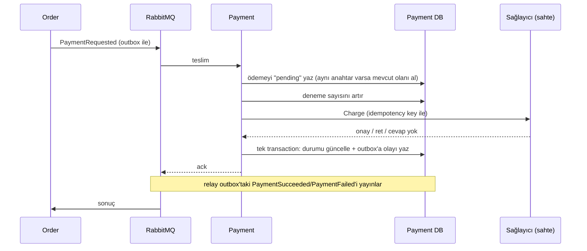
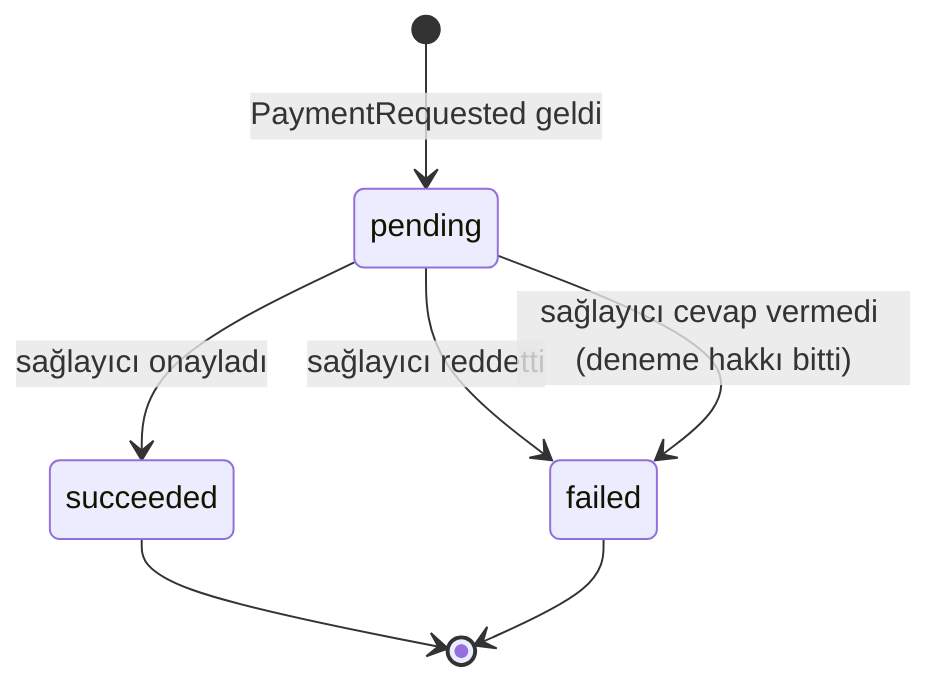

# 13 - Payment servisi

Payment, **bir siparişin parasını almaktan** sorumludur. İlk gerçek RabbitMQ kullanıcısıdır: Order servisinden `PaymentRequested` mesajını alır, ödeme sağlayıcısına (şimdilik sahte) danışır ve sonucu `PaymentSucceeded` ya da `PaymentFailed` olayı olarak yayınlar. Katman düzeni diğer servislerle aynıdır ([05](05-identity-katmanlar.md)), mesajlaşma kısmı [12](12-mesajlasma.md)'de anlatıldı. Bu bölüm Payment'a özgü kararları anlatır.

Servisin tek bir varlık nedeni var: **müşteriden bir siparişin parasını tam bir kez almak**. İki kez çekmek en kötü hatadır; hiç cevap vermemek ise siparişi sonsuza dek bekletir. Aşağıdaki kararların hepsi bu iki riske karşıdır.

## Servis sınırı

| Payment'ın | Payment'ın DEĞİL |
| --- | --- |
| Ödeme denemeleri ve durumları | Sipariş, sepet, ürün fiyatı (Order/Catalog'un) |
| Sağlayıcıyla konuşmak | Stok (Inventory'nin) |
| Sonuç olaylarını yayınlamak | Siparişi onaylamak ya da iptal etmek (Order'ın) |

Payment siparişin tutarını kendisi hesaplamaz: tutar `PaymentRequested` içinde gelir. Siparişin veritabanını da okumaz.

## Ödeme yalnızca olayla doğar

HTTP üzerinden ödeme **oluşturan, değiştiren ya da silen hiçbir uç yok**. Bu bilinçli: aksi halde "ödeme al" isteği iki farklı kapıdan girerdi ve her ikisinin de idempotent olması gerekirdi. HTTP yalnızca okumak içindir ([Okuma uçları](#okuma-uçları)). Testlerden biri tam bunu doğrular: `POST/PUT/PATCH/DELETE` denemeleri 404 ya da 405 döner.



## Durumlar



Biten bir ödeme **bir daha değişmez** (hem kodda hem `UPDATE ... WHERE status = 'pending'` ile). Müşteri başarısız olunca yeniden denerse yeni bir ödeme satırı (yeni deneme) açılır; aynı siparişin birden çok denemesi olabilir.

Hata kodları (`failure_code`) olay sözleşmesinin parçasıdır, Order bunlara bakarak müşteriye ne söyleyeceğine karar verir, bu yüzden yalnızca eklenir, adı değiştirilmez: `card_declined`, `insufficient_funds`, `expired_card`, `invalid_payment_method`, `amount_limit_exceeded`, `provider_unavailable`, `order_already_paid`.

## Tek ödeme, çok istek: idempotency anahtarı

`PaymentRequested` içindeki `idempotency_key` **mesajı değil, müşterinin ödeme niyetini** tanımlar. Order bir isteği tekrar gönderirse aynı anahtarı kullanır. Karşılığı `payments.idempotency_key` üzerindeki **UNIQUE kısıt**tır. Uygulama kodu "var mı diye bak, yoksa ekle" demez (check-then-act yarışı); tek bir `INSERT ... ON CONFLICT DO NOTHING` kullanır, aynı anda gelen 16 istek de hatasız geçer ve yalnızca biri ekler.

Aynı anahtarla ikinci bir istek geldiğinde olabilecekler:

| Mevcut ödeme | Ne olur |
| --- | --- |
| `succeeded` / `failed` | **Para çekilmez.** Saklanan sonuç yeni bir olay olarak yeniden yayınlanır (yeni `event_id`, aynı içerik) |
| `pending` (önceki işçi çökmüş) | Kaldığı yerden devam eder; sağlayıcı aynı anahtarı görünce ikinci kez çekmez |
| Farklı sipariş / müşteri / tutar | `ErrIdempotencyKeyReused`: istemci hatası, mesaj DLQ'ya gider, ilk ödemeye dokunulmaz |

Neden sonucu yeniden yayınlıyoruz? Order bir isteği tekrar gönderdiyse büyük ihtimalle ilk cevabı hiç almadı. Sessizce yok saymak onu sonsuza dek bekletirdi. Bedeli: Order, sonuç olaylarını idempotent işlemelidir; işler ([14](14-order-servisi-ve-saga.md)).

Bir sipariş yalnızca **bir kez** başarıyla ödenebilir. Farklı anahtarla (yeni niyet) aynı siparişe ikinci bir ödeme gelirse:

1. Sağlayıcıya gitmeden önce `HasSucceeded` kontrolü yapılır, ödeme `order_already_paid` ile başarısız yapılır, **para çekilmez**.
2. Yarışa karşı son savunma, veritabanındaki kısmi unique indeks (`payments_one_success_per_order_idx`): aynı siparişte ikinci bir `succeeded` kaydedilemez.

## Sağlayıcı arayüzü ve sahte sağlayıcı

`application.Provider` arayüzü, kullanıldığı yerde (application katmanında) tanımlıdır:

```go
Charge(ctx, domain.ChargeRequest) (domain.ChargeResult, error)
```

İki tür cevap vardır ve bu ayrım her şeyin temelidir:

- **Kesin cevap** (`error == nil`): `Approved` doğru ya da yanlış (ret). Ret **son sözdür**, yeniden denenmez.
- **Cevap yok** (`error != nil`): zaman aşımı, kesinti. Para çekilip çekilmediği **bilinmiyor**. Bu yüzden her çağrı idempotency anahtarını taşır.

`backend/infrastructure/provider/fake.go` sahte sağlayıcıdır. Sonucu **test kartı token'ı** belirler, böylece akışın her sonucu bilerek tetiklenebilir:

| `payment_method` | Sonuç |
| --- | --- |
| `tok_visa` | onay |
| `tok_declined` | `card_declined` |
| `tok_insufficient_funds` | `insufficient_funds` |
| `tok_expired` | `expired_card` |
| `tok_provider_error` | hiç cevap vermez |
| `tok_flaky` | ilk iki çağrıda cevap vermez, üçüncüde onaylar |
| `tok_slow` | takılır; ancak çağıranın zaman aşımı bitirir |
| başka her şey | `invalid_payment_method` |

Tutar 10.000.000 kuruşu (100.000 TL) aşarsa `amount_limit_exceeded`. Gerçek sağlayıcılar gibi sahte sağlayıcı da gördüğü anahtarı hatırlar: aynı anahtarla ikinci çağrı ilk cevabı döner. Hafızası bellektedir, servis yeniden başlayınca sıfırlanır. Docker Compose'ta `FAKE_PROVIDER_LATENCY=300ms` ile gerçekçi bir gecikme ekler.

Kartın kendisi (numara, CVV) sistemde **hiç yoktur**: yalnızca sağlayıcının verdiği token taşınır.

## Sağlayıcı cevap vermezse: sessizlik yerine kesin cevap

Sağlayıcı çökerse mesajı sonsuza dek yeniden denemek siparişi sonsuza dek bekletir. Bunun yerine:

1. Her sağlayıcı çağrısından önce `attempts` bir artırılır (veritabanında, bir `UPDATE` ile).
2. Cevap yoksa ve `attempts < PAYMENT_MAX_ATTEMPTS` (varsayılan 3) ise handler hata döner → mesaj retry kuyruğuna gider, `PAYMENT_RETRY_DELAY` sonra yeniden gelir. Ödeme `pending` kalır, **hiçbir olay yayınlanmaz** (sonuç henüz bilinmiyor).
3. Son denemede de cevap yoksa ödeme `failed` / `provider_unavailable` olur ve `PaymentFailed` yayınlanır.

Böylece Order her zaman kesin bir cevap alır. Her çağrı `PAYMENT_CHARGE_TIMEOUT` (10 sn) ile sınırlıdır.

Consumer'ın `MaxRetries` değeri `PAYMENT_MAX_ATTEMPTS + 2`dir: fazladan iki hak, kısa süreli veritabanı kesintilerinin sağlayıcı deneme hakkını yememesi içindir.

## Neden Inbox kullanılmıyor?

[12](12-mesajlasma.md)'deki `outbox.Inbox`, "işlendi" kaydını handler'ın veritabanı değişikliğiyle **aynı transaction'a** koyar. Payment'ın asıl etkisi ise bir **dış çağrıdır** (sağlayıcı); onu bir veritabanı transaction'ının içine alamazsın. O yüzden idempotency'yi alanın kendisi sağlar: anahtar üzerindeki UNIQUE kısıt, durum makinesi ve sağlayıcının kendi anahtar hafızası. Bu, handler'ı hem aynı olayın yeniden teslimine hem de aynı niyetin farklı olaylarla tekrarına karşı güvenli yapar. Inbox yalnızca ilk durumu çözerdi.

## Durum değişikliği ve olay: tek transaction

`Complete` şunları **tek transaction'da** yapar: `UPDATE payments ... WHERE status = 'pending'` ve `outbox_events`'e olayı yazmak. Sonuç: ödeme bittiyse olayı kesinlikle kuyruktadır, olay yazılamadıysa ödeme de bitmemiştir (test: olay kimliği önceden dolu olduğu için `INSERT` patlar, ödeme `pending` kalır). Eşzamanlı iki tamamlama olursa yalnızca biri `UPDATE`i uygular (`applied=true`), diğeri hiçbir şey yazmaz.

Veritabanı ayrıca tutarsız durumları reddeder (`payments_outcome_consistent`): başarılı ödemede `provider_ref` dolu, başarısızda `failure_code` dolu, bekleyende ikisi de boş olmak zorundadır.

## Okuma uçları

| Yöntem | Yol | Erişim |
| --- | --- | --- |
| GET | `/api/v1/payments/by-order/:orderId` | giriş yapmış kullanıcı, **yalnızca kendi** ödemesi |
| GET | `/api/v1/admin/payments` (`status`, `order_id`, `page`, `page_size`) | admin |
| GET | `/api/v1/admin/payments/:id` | admin |
| GET | `/api/v1/internal/payments/by-order/:orderId` | internal anahtar, gateway'den geçmez (port 8085) |

- Müşteri görünümü operasyonel ayrıntıyı (müşteri id'si, idempotency anahtarı, token, deneme sayısı, sağlayıcı referansı) **içermez**; admin görünümü içerir.
- Başkasının ödemesi **404** döner, hiç ödemesi olmayan sipariş de 404: cevaplar ayırt edilemez, böylece hangi sipariş kimliklerinin var olduğu sızmaz.
- `by-order` en yeni denemeyi döner.
- Yeni verilmiş bir siparişin ödemesi, istek asenkron olduğu için kısa süre 404 dönebilir. Order servisi geldiğinde sipariş durumu buna göre gösterilecek.

## Kod haritası

| Yol | Ne yapar |
| --- | --- |
| `backend/shared/events/payment.go` | Olay sözleşmesi: tip adları, sürümler, payload yapıları (Order da aynısını kullanacak) |
| `internal/domain/payment.go` | `Payment`, durumlar, hata kodları, `Outcome`, domain hataları |
| `internal/application/payment_service.go` | `Process`: tüm iş kuralları (idempotency, deneme sınırı, tek ödeme/sipariş) |
| `internal/application/query_service.go` | Okuma; müşteri sahiplik kuralı |
| `internal/repository/postgres/` | `Begin`, `StartAttempt`, `Complete` (+ outbox), listeleme |
| `internal/infrastructure/provider/fake.go` | Sahte sağlayıcı |
| `internal/transport/consumer/` | `PaymentRequested` handler'ı: sürüm/payload hatalarını `Permanent` yapar |
| `internal/transport/http/` | Okuma uçları |
| `migrations/00001_create_payments.sql` | `payments` + `outbox_events` + `processed_events` |

## Hata nereye gider?

| Durum | Sonuç |
| --- | --- |
| Geçersiz istek (tutar ≤ 0, para birimi TRY değil, alan eksik) | `Permanent` → DLQ, ödeme oluşmaz |
| Desteklenmeyen sürüm / okunamayan payload | `Permanent` → DLQ |
| Aynı anahtar, farklı tutar | `Permanent` → DLQ, ilk ödeme bozulmaz |
| Sağlayıcı reddetti | `PaymentFailed` yayınlanır (hata değil, kesin cevap) |
| Sağlayıcı cevap vermedi, hak var | Retry kuyruğu |
| Sağlayıcı cevap vermedi, hak bitti | `PaymentFailed` / `provider_unavailable` |
| Veritabanı kesintisi | Retry kuyruğu |

## Testler

| Test | Ne kanıtlar |
| --- | --- |
| `application/service_test.go` | Onay/ret sonuçları ve olayları; correlation id korunur; tekrar eden istek tek kez çeker ve sonucu yeniden yayınlar; yeniden kullanılan anahtar reddedilir; sağlayıcı kesintisi → retry → `provider_unavailable`; sağlayıcı toparlanırsa başarı; zaman aşımı; çökme sonrası `pending` ödemenin devamı; ödenmiş siparişe ikinci ödeme; 20 eşzamanlı istek tek çekim; geçersiz girdiler iz bırakmaz |
| `backend/infrastructure/provider/fake_test.go` | Token → sonuç eşlemesi, anahtar hafızası, `flaky`, `slow`, gecikme, eşzamanlılık |
| `transport/http/http_test.go` | Müşteri yalnızca kendi ödemesini görür, başkasının 404'ü olmayanla aynı, müşteri görünümü sızdırmaz, admin filtre/sayfalama, internal anahtar, yazma ucu yok, `alg: none` |
| `transport/consumer/payment_requested_test.go` | Okunamayan/desteklenmeyen mesajlar `Permanent` |
| `repository/postgres/integration_test.go` | (Gerçek Postgres) 16 eşzamanlı `Begin` tek satır, tek kazanan tamamlama, durum+olay atomikliği, sipariş başına tek başarı, tutarsız durumları reddeden kısıtlar |
| `transport/consumer/integration_test.go` | (Gerçek RabbitMQ + Postgres) onay → `PaymentSucceeded`, ret → `PaymentFailed`, 3 kopya istek tek ödeme ve 3 cevap, `tok_flaky` yeniden denenir, `tok_provider_error` sessizlik yerine `PaymentFailed`, geçersiz istek ve yeniden kullanılan anahtar DLQ'ya, ödenmiş siparişe ödeme çekilmez |

**Mutasyon kontrolü:** aşağıdaki bozmaların her birinde testler kırmızıya döndü:

- tekrar eden istek yeniden çekiyor
- yeniden kullanılan anahtar fark edilmiyor
- ödenmiş sipariş yine çekiliyor
- sağlayıcı kesintisi hiç başarısızlığa dönmüyor
- tamamlamada `pending` koruması yok
- tamamlama olayı kuyruğa yazmıyor
- `Begin` çakışmayı ele almıyor
- müşteriler birbirinin ödemesini görüyor

OpenAPI şeması `docs/openapi/payment.yaml`; çalışan yığına karşı sözleşme testi (`check_contract.py`) ödemeleri Order'dan gerçek checkout'larla (tüm saga'dan geçen siparişler) üretir.

## İade (Faz 6)

`RefundRequested` olayı gelince Payment siparişin `succeeded` ödemesini sağlayıcıdan geri alır, ödemeyi `refunded` yapar ve `PaymentRefunded` yayınlar. Ayrıntı, akış ve kurallar: [17](17-iade-iptal-ve-temizlik.md). Aynı siparişe iki ayrı anahtarla gelen ve yarışı kazanan **çift çekim** de artık anında iade edilir (eskiden yalnızca `DOUBLE CHARGE` loglanırdı).

## Bilinen eksikler

- Sahte sağlayıcının anahtar hafızası bellekte; servis yeniden başlayınca unutulur. Gerçek sağlayıcı bunu kendi tarafında tutar.
- `pending` kalıp hiç ilerlemeyen ödemeleri tarayan bir kurtarma işi yok (mesaj DLQ'ya düşerse). Order'ın kurtarma işi ([14](14-order-servisi-ve-saga.md)) ödeme isteğini aynı anahtarla tekrar göndererek bunu telafi eder.
- Yalnızca tam iade vardır.

## Elle denemek

Normalde `PaymentRequested`'i Order yayınlar. Payment'ı tek başına denemek için olayı RabbitMQ yönetim API'siyle de yayınlayabilirsin (`make up` sonrası; kullanıcı/parola `backend/.env` içinde):

```bash
ORDER=$(uuidgen | tr A-Z a-z); CUSTOMER=$(uuidgen | tr A-Z a-z)
python3 - "$ORDER" "$CUSTOMER" <<'EOF' | curl -s -u "$RABBITMQ_USER:$RABBITMQ_PASSWORD" -H 'content-type: application/json' \
  -X POST localhost:15672/api/exchanges/%2F/rovena.events/publish -d @-
import json, sys, uuid, datetime
order, customer = sys.argv[1:]
env = {"event_id": str(uuid.uuid4()), "type": "PaymentRequested", "version": 1,
       "occurred_at": datetime.datetime.now(datetime.timezone.utc).isoformat(), "correlation_id": "elle-" + order[:8],
       "payload": {"order_id": order, "customer_id": customer, "idempotency_key": "elle-" + order,
                   "amount_cents": 459900, "currency": "TRY", "payment_method": "tok_visa"}}
print(json.dumps({"properties": {"delivery_mode": 2, "content_type": "application/json"},
                  "routing_key": "PaymentRequested", "payload": json.dumps(env), "payload_encoding": "string"}))
EOF
# sonuç (servis portu 8085, internal anahtar)
curl -s -H "X-Internal-Key: $INTERNAL_API_KEY" localhost:8085/api/v1/internal/payments/by-order/$ORDER
```

`payment_method` değerini `tok_declined`, `tok_flaky` gibi değiştirip farklı sonuçları dene. Aynı isteği ikinci kez yayınlarsan ödeme tekrarlanmaz, sonuç yeniden yayınlanır (`payment` loglarında "duplicate payment request, result sent again").
