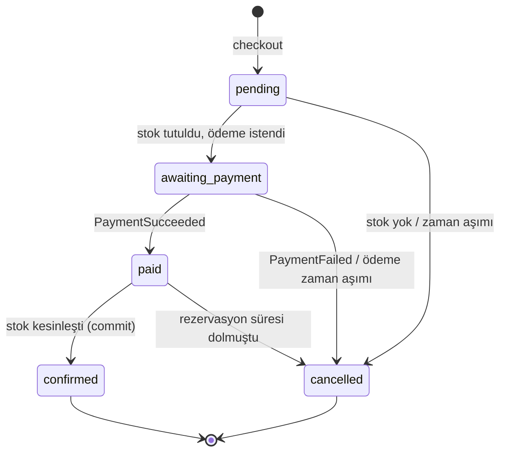
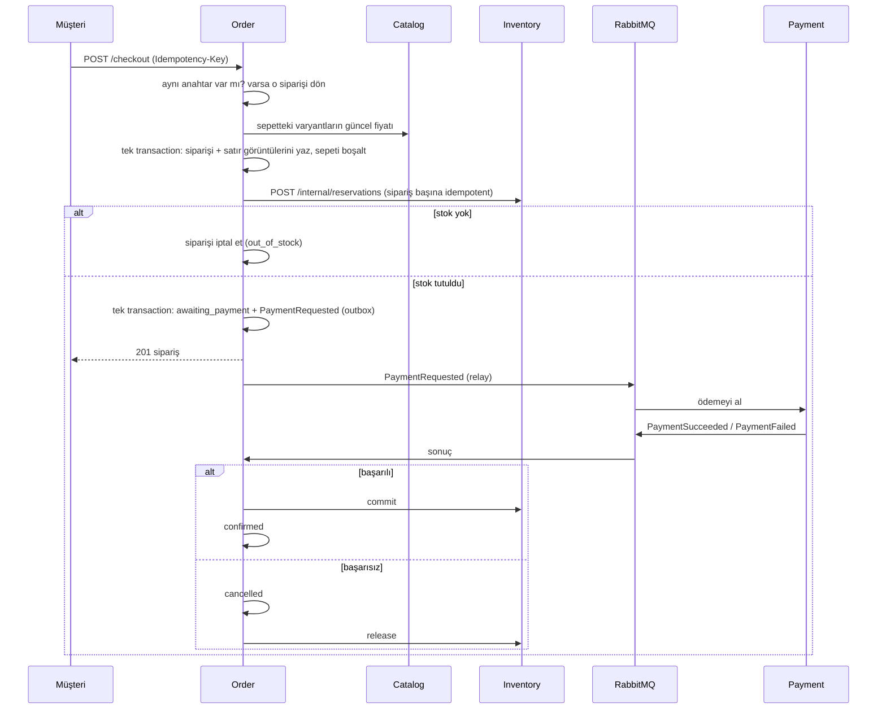

# 14 - Order servisi ve checkout Saga

Order, **sepeti siparişe çeviren** ve bu sırada diğer üç servisi (Catalog, Inventory, Payment) sırayla çalıştıran servistir. Projenin en "dağıtık" parçası burası: tek bir müşteri işlemi (satın al) üç ayrı veritabanını ve bir mesaj kuyruğunu ilgilendirir, ve hiçbirini kapsayan tek bir transaction yoktur. Bu bölüm bu işin nasıl güvenli yapıldığını anlatır. Mesajlaşma altyapısı [12](12-mesajlasma.md)'de, ödeme tarafı [13](13-payment-servisi.md)'te, stok tarafı [11](11-inventory-servisi.md)'de anlatıldı; burada onları birbirine bağlayan **Saga** var.

## Servis sınırı

| Order'ın | Order'ın DEĞİL |
| --- | --- |
| Sepet (variant id + adet) | Ürün adı ve fiyatı (Catalog'un) |
| Sipariş, satır görüntüleri (snapshot), durum geçmişi | Stok sayıları (Inventory'nin) |
| Saga'yı yürütmek, takılan siparişi toparlamak | Para çekmek (Payment'ın) |

Order başka bir servisin tablosuna dokunmaz. Fiyatı Catalog'a **sorar** (REST), stoğu Inventory'ye **sorar** (REST), ödemeyi Payment'a **ister** (olay) ve sonucunu **dinler** (olay).

## Sepet: istemciye güvenme

Sepet tablosu yalnızca `(müşteri, variant_id, adet)` tutar. İsim ve fiyat **hiç saklanmaz**: sepet gösterilirken ve sipariş verilirken Catalog'dan o anki değerler alınır. İstemci gövdede `price_cents` gönderse bile alan okunmaz bile; testler bunu doğrular (`TestCart_ClientPriceIsIgnored`, sözleşme testinde de aynı kontrol var).

Kurallar: adet 1–99, sepette en fazla 50 farklı varyant, varyant satışta olmalı. 50 sınırı eşzamanlı eklemelerde de tutar: sepet satırı kilitlenir, sayılır, sonra eklenir (`TestCart_CapHoldsUnderConcurrentAdds`, 70 eşzamanlı ekleme, tam 50 başarılı).

Sepette bir varyant sonradan kapatılırsa satır **listede kalır** ama `available: false` olur ve toplama girmez; checkout o satırı adıyla reddeder (`409`, `fields.variant_id`).

Catalog'a bu iş için yeni bir **dahili uç** eklendi: `POST /api/v1/internal/variants/lookup`. Gateway'den geçmez, `X-Internal-Key` ister (Inventory'nin rezervasyon uçlarıyla aynı mantık). Verilen id'lerin güncel ad/fiyat/`sellable` bilgisini döner, bilinmeyenleri sessizce atlar. `sellable` yalnızca **hem varyant hem ürün** `active` ise doğrudur.

## Sipariş durumları



`paid` ayrı bir durum çünkü "para alındı" ile "stok kesinleşti" iki ayrı servisteki iki ayrı olay. Aralarında Inventory kapalı olabilir; o zaman sipariş `paid`'de bekler ve bir sonraki deneme tamamlar. `confirmed` ve `cancelled` son durumlardır.

Siparişin **stok tarafı** ayrıca `reservation_state` sütununda izlenir: `none` → `held` → `committed` | `released`. Böylece "iptal oldu ama stok hâlâ tutuluyor" gibi yarım kalmış durumlar sorgulanabilir; kurtarma işi tam bunları arar.

Her geçiş `order_status_history` tablosuna da yazılır. Müşteri bu geçmişi durum + zaman olarak görür; admin sebebiyle birlikte görür.

## Checkout: adım adım



Yanıt **ödeme bitmeden** döner: `201` ve `status: awaiting_payment`. İstemci siparişi `GET /orders/{id}` ile sorgulayarak `confirmed` ya da `cancelled` olmasını bekler.

### Sipariş, fiyat görüntüsü (snapshot) ve sepet tek transaction'da

Sipariş, satırları ve sepetin boşaltılması **aynı transaction'dır**. Bu transaction önce müşterinin sepet satırını kilitler, sonra sepetin içeriğinin fiyatlandırılan içerikle **aynı** olduğunu doğrular. Farklıysa (müşteri başka sekmede sepeti değiştirmişse) hiçbir şey yazılmadan `409` döner. İki sonuç buradan çıkar:

- Aynı sepetten, farklı anahtarlarla gelen iki eşzamanlı checkout: yalnızca biri sipariş oluşturur (`TestCreate_ConcurrentCheckoutsWithDifferentKeysStillMakeOneOrder`).
- Eski bir fiyat/adetle sipariş oluşmaz.

Satır görüntüsü (`order_items`) ürünün adını, SKU'sunu, bedenini, rengini ve **o anki birim fiyatı** kopyalar. Sonradan Catalog'da fiyat ya da ad değişse sipariş değişmez (`TestCheckout_TheOrderKeepsThePricesOfTheMoment`).

### Idempotency-Key

Her checkout `Idempotency-Key` başlığı ister (1–64 yazdırılabilir ASCII, boşluksuz). Anahtar **müşteri başınadır**: iki müşterinin aynı anahtarı kullanması çakışma değildir. `orders` tablosunda `UNIQUE (customer_id, idempotency_key)` vardır.

| Durum | Sonuç |
| --- | --- |
| İlk istek | `201`, yeni sipariş |
| Aynı anahtar, aynı ödeme yöntemi | `200`, **aynı sipariş** (ikinci sipariş yok, ikinci rezervasyon yok, ikinci ödeme yok) |
| Aynı anahtar, farklı ödeme yöntemi | `422` |
| Aynı anahtar, ilk istek yarıda kalmış (sipariş `pending`) | İkinci istek işi tamamlar |

Aynı anda gelen on istek de aynı siparişi döner ve yalnızca biri "oluşturdum" der (`TestSaga_ConcurrentCheckoutRetriesWithOneKeyReserveOnce`).

Ödeme tarafındaki anahtar ise **siparişten türetilir**: `order:<sipariş id>`. Kurtarma işi ödemeyi tekrar isterse aynı anahtar gider ve Payment tekrar çekmez, sakladığı sonucu yeniden yayınlar ([13](13-payment-servisi.md)).

## Saga'nın her adımı tekrar edilebilir

Dağıtık bir akışta "bu adım iki kez çalışırsa ne olur?" sorusunun cevabı her yerde "hiçbir şey" olmalı. Order bunu iki araçla sağlar:

1. **Korumalı geçişler.** Her durum değişikliği `UPDATE ... WHERE durum IN (beklenen durumlar)` olarak çalışır ve değişip değişmediğini döner. İkinci çağrı beklenen durumu bulamaz, hiçbir şey yapmaz. Olay (outbox) durum değişikliğiyle **aynı transaction'da** yazıldığı için "durum değişti ama olay yok" ya da tersi olamaz (`TestTransition_StatusAndEventStandOrFallTogether`).
2. **Idempotent dış çağrılar.** Inventory'nin rezervasyon, commit ve release uçları tekrar edilebilir ([11](11-inventory-servisi.md)).

Sonuç: aynı `PaymentSucceeded` 12 eşzamanlı teslim edilse bile sipariş bir kez onaylanır ve tek bir `OrderConfirmed` olayı çıkar (`TestSaga_ConcurrentDuplicatePaymentResultsConfirmOnce`, gerçek Postgres).

Bu yüzden Order tarafında **Inbox kullanılmıyor**, Payment'taki gerekçeyle aynı: asıl etki başka bir servise yapılan çağrı, bir veritabanı transaction'ı onu kapsayamaz; idempotency durum makinesinden gelir.

### Ödeme sonucu geldiğinde

| Olay | Sipariş şu durumdaysa | Ne olur |
| --- | --- | --- |
| `PaymentSucceeded` | `awaiting_payment` | `paid`, sonra commit, sonra `confirmed` |
| | `paid` | Sadece commit'i tekrar dener (önceki deneme Inventory yüzünden yarım kalmıştı) |
| | `confirmed` | Hiçbir şey (tekrar teslim) |
| | `cancelled` | Sipariş **iptal kalır**; para alındığı için `RefundRequested` kuyruğa alınır ve para geri verilir ([17](17-iade-iptal-ve-temizlik.md)) |
| `PaymentFailed` | `awaiting_payment` | `cancelled` (sebep: ödeme hata kodu), sonra release |
| | `cancelled` | Release'i tekrar dener |
| | `paid` / `confirmed` | Yok sayılır. Payment ikinci bir ödeme isteğini `order_already_paid` ile reddettiğinde bu olay gelir ve gerçek siparişi etkilememelidir |

İki koruma daha:

- **Tutar kontrolü.** `PaymentSucceeded` içindeki tutar ve para birimi siparişinkiyle birebir eşleşmezse sipariş **onaylanmaz**, `PAYMENT AMOUNT MISMATCH` loglanır ve mesaj DLQ'ya gider. Başka bir şey için para çekilmiş olabilir; bunu bir insanın görmesi gerekir.
- **Bilinmeyen sipariş / geçersiz sürüm / bozuk payload.** Tekrar denemekle düzelmez, mesaj doğrudan DLQ'ya gider. Inventory'nin ulaşılamaması ise düzelebilir, mesaj retry kuyruğuna gider (`TestInventoryOutageIsRetried`).

### Rezervasyon süresi ödemeden önce dolarsa

Inventory rezervasyonu 15 dakika sonra kendiliğinden bırakır. Ödeme bu süreden sonra başarıyla biterse commit `ErrReservationGone` döner. Order siparişi `cancelled` (`reservation_lost`) yapar ve parayı iade ettirir ([17](17-iade-iptal-ve-temizlik.md)).

## Takılan siparişi toparlayan kurtarma işi

Saga'nın her adımından sonra süreç çökebilir. Dört durum için bir arka plan işi (`Recover`, 15 saniyede bir) şunları arar:

| Takılma | Bulgu | Ne yapılır |
| --- | --- | --- |
| Stok hiç tutulamadı (Inventory kapalıydı, süreç çöktü) | `pending`, 30 sn'den eski | Rezervasyonu yeniden dener (idempotent). **5 dakikada** hâlâ olmuyorsa `checkout_timeout` ile iptal |
| Ödeme cevabı gelmedi (mesaj kayboldu, Payment kapalı) | `awaiting_payment`, 2 dakikadan eski | `PaymentRequested` tekrar gönderilir (**en çok 3 kez**). 3. istek de cevapsız kalırsa `payment_timeout` ile iptal + release |
| Para alındı ama commit yapılamadı | `paid` | Commit tekrar denenir |
| İptal edildi ama stok serbest bırakılamadı | `cancelled` + `reservation_state = held` | Release tekrar denenir |

Zaman değerleri ortam değişkenidir (`ORDER_STUCK_AFTER`, `ORDER_PAYMENT_TIMEOUT`, `ORDER_MAX_PAYMENT_REQUESTS`, `ORDER_PENDING_MAX_AGE`, `ORDER_RECOVERY_INTERVAL`). Başarısız bir deneme siparişin `updated_at` zamanını ileri alır; böylece Inventory kapalıyken iş her 15 saniyede aynı siparişe saldırmaz (`TestRecovery_BacksOffAfterAFailedAttempt`).

Son güvenlik ağı Inventory'dedir: Order tamamen kaybolsa bile rezervasyon süresi dolunca stok kendiliğinden geri döner.

**Gerçek yığında denendi.** Payment durduruldu, bir sipariş verildi, `PaymentRequested` mesajı kuyruktan silindi (kayıp mesaj), Payment tekrar başlatıldı. Sipariş 130 saniye sonra, kurtarma işinin ikinci ödeme isteğiyle `confirmed` oldu.

## Okuma uçları

| Uç | Kim |
| --- | --- |
| `GET /api/v1/cart`, `PUT/DELETE /cart/items/{variantId}`, `DELETE /cart` | giriş yapmış kullanıcı, kendi sepeti |
| `POST /api/v1/checkout` | aynı |
| `GET /api/v1/orders`, `GET /orders/{id}` | aynı, **yalnızca kendi siparişleri** |
| `GET /api/v1/admin/orders[/{id}]` | admin |

Müşteri id'si hiçbir yolda yok; her zaman token'dan gelir. Başkasının siparişi `404` döner (id'nin var olup olmadığı sızmaz). Müşteri yanıtında ödeme yöntemi token'ı, idempotency anahtarı, rezervasyon id'si, müşteri id'si ve saga sayaçları **görünmez** (`TestOrders_CustomerViewHidesInternals`); admin görünümü bunları gösterir.

## Kod haritası

```
services/order/
├── migrations/00001_create_orders.sql     carts, cart_items, orders, order_items, order_status_history + outbox/inbox
├── internal/domain/order.go               Order, Status, ReservationState, hatalar
├── internal/application/
│   ├── ports.go                           Catalog ve Inventory arayüzleri (bağımlılık yönü içe doğru)
│   ├── cart_service.go                    sepet
│   ├── order_service.go                   Checkout + ilk saga adımı (advance)
│   ├── saga.go                            PaymentSucceeded/Failed işleyicileri, settle (commit/release)
│   ├── recovery.go                        kurtarma işi
│   └── query_service.go                   okuma
├── internal/repository/postgres/          korumalı geçişler, sepet kilitleri
├── internal/repository/memory/            testler için aynı kuralları uygulayan bellek içi repo
├── internal/infrastructure/clients/       Catalog ve Inventory REST istemcileri (zaman aşımlı)
├── internal/transport/http/               sepet, checkout, sipariş uçları
└── internal/transport/consumer/           order.payment-results kuyruğu
```

Catalog ve Inventory istemcilerinin kendi yeniden deneme mantığı yoktur: tek deneme, 5 saniye zaman aşımı. Yeniden deneme işini kurtarma işi yapar; böylece her çağrı için ayrı bir "kaç kez, ne kadar bekle" kuralı yazılıp birbirini çarpan yeniden denemeler oluşmaz.

## Hata nereye gider?

| Durum | Müşteri ne görür |
| --- | --- |
| Catalog'a ulaşılamadı | `503`, hiçbir şey oluşmadı, sepet duruyor |
| Inventory'ye ulaşılamadı | `201`, sipariş `pending`; arka planda tamamlanır ya da 5 dakikada iptal olur |
| Stok yetersiz | `201`, sipariş `cancelled` (`out_of_stock`); deneme kayıtlı kalır |
| Sepetteki ürün artık satılmıyor | `409`, hangi varyant olduğu `fields.variant_id` içinde |
| Sepet checkout sırasında değişti | `409`, hiçbir şey oluşmadı |
| Kart reddedildi | Sipariş sonunda `cancelled`, `failure_code: card_declined` |
| Sağlayıcı cevap vermiyor | `cancelled`, `failure_code: provider_unavailable` |

## Testler

| Dosya | Ne kanıtlıyor |
| --- | --- |
| `application/service_test.go` | 41 test: sepet kuralları, checkout (tekrar, yarış, snapshot, stok yok, Inventory kesintisi, sepet değişti), ödeme sonuçları (tekrar teslim, geç başarı, yanlış tutar, rezervasyon kaybı), kurtarma (yeniden iste, vazgeç, geri çekil) |
| `transport/http/http_test.go` | Her yol token ister, admin yolları müşteriye kapalı, fiyat yok sayılır, başkasının siparişi 404, müşteri yanıtı iç bilgileri sızdırmaz |
| `transport/consumer/payment_result_test.go` | Düzelmeyecek mesajlar DLQ'ya, düzelebilecekler retry'a |
| `repository/postgres/integration_test.go` | (Gerçek Postgres) eşzamanlı checkout tek sipariş, sepet sınırı, tek kazanan geçiş, durum+olay atomikliği, CHECK kısıtları, eşzamanlı çift ödeme sonucu tek onay |
| `catalog/.../internal_test.go`, `postgres/integration_test.go` | Dahili arama ucu: anahtar şart, sellable kuralı, bilinmeyen id atlanır |

Mutasyon kontrolü (kodu bilerek bozup testlerin kırmızıya döndüğünü görmek) 21 senaryoda yapıldı ve hepsi yakalandı. Bazıları: tekrar eden anahtar yeni sipariş açıyor, tutar karşılaştırılmıyor, `PaymentFailed` ödenmiş siparişi iptal ediyor, iptal edilen sipariş stoğu bırakmıyor, ödeme istekleri farklı anahtar taşıyor, kurtarma hiç vazgeçmiyor, başkasının siparişi okunabiliyor, admin yolları müşteriye açık, sepet kilitsiz, geçiş her durumdan çalışıyor, geçiş olayı yazmıyor.

Bir mutasyon (ödenmiş siparişi `PaymentFailed`'ın iptal etmesi) ilk denemede **yakalanmadı**: servis katmanındaki yanlışı repository'nin korumalı geçişi örtüyordu. İki katmanı birlikte bozunca yakalandı. Yani koruma iki katmanda ve testler ikisini de ayrı ayrı sınamıyor; bilinçli bir savunma derinliği.

## Faz 6'da eklenenler

Aşağıdakiler [17](17-iade-iptal-ve-temizlik.md)'de anlatılır; burada yalnızca bu bölümün anlattığı akışı nasıl değiştirdikleri var.

- **Para iadesi.** Eskiden "para alındı ama sipariş iptal" durumu yalnızca loglanırdı (`REFUND NEEDED`). Artık sipariş `refund_state` (`none → requested → refunded`) taşır, iade istemi aynı transaction'da outbox'a yazılır ve kurtarma işi cevapsız iade isteğini tekrar eder.
- **Müşteri iptali:** `POST /orders/{id}/cancel`. Ödeme sürerken de serbest; çekim yine de olursa iade edilir.
- **İptalde sepet geri gelir** (müşterinin kendi iptali hariç).
- Ek olarak ödeme sonuçları kuyruğu artık `PaymentRefunded`'ı da dinler.

## Bilinen eksikler

- Kurtarma işi her Order kopyasında çalışır; çakışma korumalı geçişlerle zararsızdır, ama gereksiz iş yapar. Tek kopya varsayımı.
- `OrderConfirmed` ve `OrderCancelled` olaylarını henüz kimse dinlemiyor (bildirim, e-posta için kanca).
- İade her zaman siparişin tamamıdır; kısmi iade yok.

## Elle denemek

```bash
G=localhost:8080
EMAIL=deneme-$RANDOM@example.com; PW='Passw0rd!Passw0rd'
curl -s -X POST $G/api/v1/auth/register -H 'content-type: application/json' \
  -d "{\"email\":\"$EMAIL\",\"password\":\"$PW\",\"first_name\":\"A\",\"last_name\":\"B\"}" >/dev/null
TOKEN=$(curl -s -X POST $G/api/v1/auth/login -H 'content-type: application/json' \
  -d "{\"email\":\"$EMAIL\",\"password\":\"$PW\"}" | python3 -c 'import sys,json;print(json.load(sys.stdin)["data"]["tokens"]["access_token"])')

# bir varyant seç (make seed-catalog ve make seed-inventory çalışmış olmalı)
PID=$(curl -s "$G/api/v1/products?page_size=1" | python3 -c 'import sys,json;print(json.load(sys.stdin)["data"]["items"][0]["id"])')
VID=$(curl -s $G/api/v1/products/$PID | python3 -c 'import sys,json;print(json.load(sys.stdin)["data"]["variants"][0]["id"])')

curl -s -X PUT $G/api/v1/cart/items/$VID -H "authorization: Bearer $TOKEN" -H 'content-type: application/json' -d '{"quantity":2}'
curl -s -X POST $G/api/v1/checkout -H "authorization: Bearer $TOKEN" -H 'content-type: application/json' \
  -H "Idempotency-Key: $(uuidgen)" -d '{"payment_method":"tok_visa"}'
curl -s $G/api/v1/orders -H "authorization: Bearer $TOKEN"
```

`payment_method` yerine `tok_declined` (reddedilir), `tok_flaky` (iki kez hata, sonra onay) ya da `tok_provider_error` (sağlayıcı hiç cevap vermez) dene. Servis günlüklerinde `correlation_id` sipariş id'sidir: `docker compose logs order payment | grep <sipariş id>` tek bir checkout'un izini verir.
