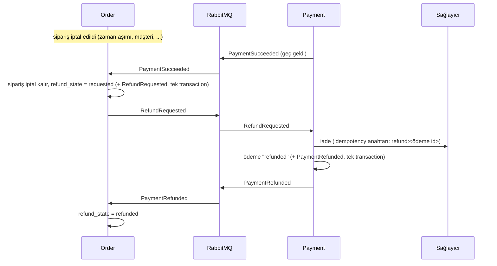

# 17 - İade, iptal, temizlik ve alınan kararlar

Faz 6, önceki fazlarda bilerek açık bırakılmış borçları kapattı. Bu bölüm bunları anlatır: **para iadesi**, **müşteri iptali**, **iptalde sepetin geri gelmesi**, **outbox temizliği**, **iki sekmede oturum** sorunu, **gateway hata gövdeleri** ve iki "karar ver" maddesinin gerekçeli cevabı.

## Para iadesi

Daha önce para alınıp sipariş iptal kalabiliyordu ve bunun tek izi bir log satırıydı (`REFUND NEEDED`). Artık uçtan uca bir akış var.

### Hangi durumlarda iade istenir?

| Durum | Sebep (`reason`) |
| --- | --- |
| Sipariş `payment_timeout` ile iptal edildi, ödeme sonradan başarılı oldu | `payment_timeout` |
| Müşteri ödeme sürerken iptal etti, çekim yine de gerçekleşti | `cancelled_by_customer` |
| Ödeme geldiğinde stok rezervasyonu süresi dolmuştu (commit reddedildi) | `reservation_lost` |
| Aynı siparişe iki ayrı anahtarla iki istek yarıştı, sağlayıcı ikisini de çekti | Payment **kendisi** iade eder (aşağıda) |

### Kurallar

- **Ödeme durumları:** `pending → succeeded → refunded` (ve `failed`). `refunded` sondur. Para alınmış sayılan durumlar `succeeded` ve `refunded`'dır: iade edilmiş siparişe başka anahtarla yeniden ödeme alınamaz (kısmi unique indeks ikisini kapsar).
- **Idempotent:** Aynı sipariş için iade isteği kaç kez gelirse gelsin sağlayıcıya bir kez gidilir; sonraki istekler saklanan sonucu `PaymentRefunded` olarak yeniden yayınlar (Order ilkini kaçırmış olabilir). Bu, Payment'taki `PaymentRequested` mantığının aynısıdır.
- **Sağlayıcı cevap vermezse:** Hata tüketiciye döner, mesaj retry kuyruğuna gider. Ödeme `succeeded` kalır. Hiçbir şey yarım yazılmaz.
- **Ödenmemiş siparişin iadesi istenirse** (`ErrNothingToRefund`): düzelmeyecek bir hata, mesaj doğrudan DLQ'ya gider. Order bunu yalnızca bir `PaymentSucceeded` görünce ister, yani normalde olmaz.
- **Order tarafı:** Siparişin `refund_state` değeri `none → requested → refunded`. Veritabanı kısıtı iade durumunun yalnızca iptal edilmiş siparişte olabileceğini zorlar. Durum ve `RefundRequested` olayı aynı transaction'da yazılır (korumalı geçiş, [14](14-order-servisi-ve-saga.md)).
- **Kurtarma:** `PaymentRefunded` gelmezse kurtarma işi 2 dakikada bir (en çok 5 kez) isteği tekrarlar. Beşincide `REFUND STUCK` loglanır ve `RefundNotAnswered` uyarısı yanar; o noktadan sonra bir insan bakmalı.
- **Tutar kontrolü:** `PaymentRefunded` içindeki tutar siparişinkiyle uyuşmazsa iade kapatılmaz (`REFUND AMOUNT MISMATCH`, DLQ).

### Çift çekim: Payment kendini düzeltir

Faz 2'de "aynı siparişe farklı anahtarla eşzamanlı iki istek" durumunda sağlayıcı ikisini de çekebiliyor, veritabanı ikinci başarıyı reddediyor ve yalnızca `DOUBLE CHARGE` loglanıyordu. Artık Payment ikinci çekimi **hemen iade eder** (`duplicate:<ödeme id>` anahtarıyla) ve o ödemeyi `failed / order_already_paid` olarak bitirir. İade de başarısız olursa hata döner ve mesaj tekrar denenir; ödeme `pending` kalır, böylece unutulmaz.

Sağlayıcı arayüzü (`Provider`) artık `Refund` metodunu da içerir. Sahte sağlayıcı iadeyi anahtar başına bir kez yapar.

## Müşteri iptali

`POST /api/v1/orders/{id}/cancel`:

| Sipariş durumu | Sonuç |
| --- | --- |
| `pending`, `awaiting_payment` | İptal edilir (`cancelled_by_customer`), stok bırakılır |
| zaten `cancelled` | 200, sipariş olduğu gibi (idempotent; başka sebeple iptal olduysa o sebep korunur) |
| `paid`, `confirmed` | **409**: ödenmiş sipariş artık iptal edilemez |
| başkasının siparişi | 404 |

**Ödeme sürerken iptal bilerek serbest.** Alternatif, ödeme bitene kadar iptali reddetmekti; ama o zaman müşteri "iptal ettim" dedikten sonra siparişin onaylanması olasılığı kalırdı. Şimdi iptal anında kesin: sipariş iptal, stok serbest. Çekim yine de gerçekleşirse yukarıdaki iade akışı parayı geri verir. Yarış iki yönlü sınandı: iptal ödemeden önce gelirse iade; ödeme önce gelirse (sipariş `paid`/`confirmed`) iptal reddedilir.

İptal sırasında Inventory'ye ulaşılamazsa müşterinin isteği **başarısız olmaz**: sipariş iptal edilir, stok bırakma işini kurtarma işi tamamlar.

## İptalde sepet geri gelir

Checkout sepeti boşaltıyordu; stok yetmeyince ya da kart reddedilince müşteri boş sepetle kalıyordu. Artık sipariş **müşteri dışındaki her sebeple** iptal edilince (stok yok, ürün kalkmış, kart reddi, zaman aşımı, rezervasyon kaybı) siparişin kalemleri sepete geri konur.

- Müşteri bu arada sepete aynı ürünü yeniden eklediyse **onun yeni seçimi korunur** (üzerine yazılmaz).
- Sepet sınırı (50 satır) yine geçerlidir; sığmayanlar eklenmez.
- Kalemler artık satılmıyorsa sepette `available: false` görünür; mevcut sepet kuralları aynen işler.
- Müşterinin kendi iptalinde sepet **boş kalır**: o onun tercihidir.

## Checkout'ta yakalanan yarış

Aynı `Idempotency-Key` ile eşzamanlı istekler gönderildiğinde, "anahtar var mı?" kontrolünden **hemen sonra** ikizi siparişi oluşturup sepeti boşaltabiliyordu; bu istek boş sepet görüp "sepet boş" hatası veriyordu (ikizinin siparişini dönmesi gerekirdi). Entegrasyon testi arada bir yakaladı. Artık boş sepet görünce anahtara bir kez daha bakılır; sipariş varsa o dönülür. Birim testi bu aralığı bir kanca ile zorlar.

## Outbox ve inbox temizliği

`outbox_events` yayınlandıktan sonra, `processed_events` ise eskidikçe sonsuz büyüyordu. `outbox.Cleaner` (Payment ve Order'da arka planda çalışır):

- **Yayınlanmış** outbox satırlarını `OUTBOX_RETENTION` (varsayılan 7 gün) sonra siler. **Yayınlanmamış satıra asla dokunmaz**, ne kadar eski olursa olsun: o olayı kimse duymamıştır.
- Eski inbox işaretlerini aynı süreyle siler. Süre, bir mesajın yeniden teslim edilebileceği en uzun süreden büyük olmalı; işaret, tekrarı tanıyan şeydir.
- 1000'lik partilerle siler (uzun kilit tutmaz), saatte bir çalışır (`OUTBOX_CLEAN_INTERVAL`), silinen satırlar `outbox_cleaned_rows_total` ile sayılır.
- İlgili indeksler eklendi (`00003` migration'ları).

Testler: eski+yayınlanmış silinir, yeni+yayınlanmış kalır, eski+yayınlanmamış kalır; 2500 satırlık birikim tek turda gider; relay ile aynı anda çalışınca hiçbir olay kaybolmaz.

## Oturum: iki sekme aynı anda yenilerse

Refresh token tek kullanımlıktır; kullanılmış bir token gelince "çalınmış" sayılıp kullanıcının **tüm oturumları kapatılır**. İki tarayıcı sekmesi aynı anda yenileme yapınca ikincisi tam olarak bu görünüme sahipti ve kullanıcıyı sebepsiz çıkarıyordu.

Çözüm: **kısa bir hoşgörü süresi** (`REFRESH_TOKEN_GRACE`, varsayılan 10 saniye).

- Yenileme ile iptal edilen token artık `rotated_at` taşır. **Çıkış (logout) bir rotasyon değildir:** çıkış yapılmış token'a hoşgörü tanınmaz.
- Rotasyondan en çok 10 saniye sonra aynı token yine gelirse bu bir hırsızlık sayılmaz; ikinci sekmeye **kendi** yeni çifti verilir (ilkinin token'ı korunur). Sonuç: iki sekme, iki ayrı oturum zinciri.
- 10 saniyeden sonra gelirse eskisi gibi: tüm oturumlar kapanır.
- Süresi dolmuş token'a hoşgörü yok. `REFRESH_TOKEN_GRACE=0` özelliği kapatır.

Bedeli açık: token'ı çalan biri, sahibinin yenilemesinden **sonraki 10 saniye içinde** kullanırsa bu çalma o anda yakalanmaz. Pencere kısa tutuldu ve ayarlanabilir. Eşzamanlı sekiz yenileme gerçek Postgres'te denendi: hepsi başarılı, hepsi farklı token aldı, hiçbiri çıkış yaptırmadı.

## Gateway hata gövdeleri

Hız sınırı (429) zaten JSON dönüyordu. Artık gateway'in **kendi ürettiği** diğer hatalar da servislerle aynı zarfı kullanır: `404` (bilinmeyen yol), `413` (gövde çok büyük), `502`/`503`/`504` (servis kapalı/yavaş). Servisten gelen yanıtlar (`404 Product not found` gibi) değiştirilmeden geçer. İstemci tek bir hata biçimi çözer.

## Gözlemlenebilirlik eklemeleri

- **Veritabanı span'ları:** her sorgu, onu tetikleyen isteğin ya da mesajın iz'inde bir span olur (`telemetry.InstrumentBun`). SQL yer tutucularıyla kaydedilir, **değerler asla**: e-posta ve token gibi bilgiler iz'e sızmaz.
- **Grafana** (`http://localhost:3000`, geliştirme ortamında giriş yok): "Rovena overview" panosu hazır gelir: istek/hata/gecikme, mesaj sonuçları ve kuyruk derinliği, outbox birikimi, sipariş ve ödeme sonuçları, kurtarma işi eylemleri, iadeler. Kaynağı `infrastructure/grafana/` altında; UI'dan değil dosyadan düzenlenir.
- **Uyarı kuralları** (`infrastructure/prometheus/alerts.yml`, 11 kural): servis kapalı, 5xx oranı, yavaş istek, outbox birikimi/takılan olay, **DLQ'da mesaj var**, kuyruk birikimi, sürekli yeniden deneme, kurtarma işi meşgul, **iade cevapsız**, siparişlerin yarısından çoğu iptal. Alertmanager yok: yanan uyarılar Prometheus'un `Alerts` sayfasında ve panoda görünür. Bildirim (e-posta, Slack) için Alertmanager ya da Grafana contact point eklenmeli.
- **Örnekleme:** Trace'lerin tamamı kaydedilir. Gerçek trafikte oranı düşürmek için standart ortam değişkenleri çalışır: `OTEL_TRACES_SAMPLER=parentbased_traceidratio`, `OTEL_TRACES_SAMPLER_ARG=0.1`.

## Alınan kararlar

### Yeni varyant için Inventory'de stok kaydı otomatik açılsın mı? Hayır.

Soru: Catalog'a yeni varyant eklenince Inventory'de `VariantCreated` olayıyla otomatik 0 stoklu kayıt açılsın mı?

**Karar: hayır, stok kaydı bilerek elle (admin) açılır.**

- Kayıt açmak için **başlangıç miktarı** gerekir ve bunu Catalog bilmez; otomatik açılan 0'lık kayıt yeni bir bilgi taşımaz. Bugünkü davranış zaten güvenli: kaydı olmayan varyant `GET /stock` ile "0, stokta yok" görünür, rezervasyonda `item_unavailable` ile reddedilir, sepet iade edilir.
- Otomatik açmak Catalog'a bir outbox, Inventory'ye bir tüketici ekler. Şu an Inventory'nin hiç mesaj tüketicisi yok (hibrit checkout kararı, [11](11-inventory-servisi.md)). Kazanç küçük, hareketli parça artışı gerçek.
- Depoya mal girişi zaten bir insan eylemidir; SKU'yu depoda tanımlamak o eylemin parçasıdır.

**Ne zaman yeniden bakılır:** toplu ürün içe aktarımı gelirse ya da admin arayüzü "ürün + başlangıç stoğu" tek ekranda isterse. O zaman olay yerine arayüzün iki servise sırayla çağrı yapması (ya da küçük bir BFF) daha ucuz olabilir.

Bilinen sonuç: Catalog'da yayında ama Inventory'de kaydı olmayan bir ürün vitrinde görünür, "stokta yok" diye işaretlenir. Müşteri sepete ekleyebilir, checkout `item_unavailable` ile iptal olur. Bu bilinen bir tuzak olarak `todo.md`'de duruyor.

### Servisler arası JWT: HS256 yerine asimetrik imza? Değerlendirildi, ertelendi.

**Bugünkü durum:** Tüm servisler aynı `JWT_SECRET`'i taşır. Asıl risk şu: **herhangi bir servisin ele geçirilmesi, admin token'ı üretebilmek demektir.** Token'ı doğrulamak için gereken sır, imzalamak için gereken sırrın aynısıdır.

**Seçenek:** Ed25519 (EdDSA). Yalnızca Identity özel anahtarı tutar; diğer servisler yalnızca açık anahtarı alır ve token **doğrulayabilir ama üretemez**.

**Göç planı (yapılırsa):**
1. Identity bir anahtar çifti üretir/yükler (`JWT_PRIVATE_KEY`); açık anahtarı `/.well-known/jwks.json` ile `kid` ile yayınlar (anahtar döndürme için).
2. `shared/auth.Verifier` anahtar kümesi alır; yalnızca EdDSA kabul eder. HS256 token'ı açık anahtarı "sır" gibi kullanarak doğrulatma saldırısı (algorithm confusion) için ayrı test yazılır; mevcut `alg: none` testi gibi.
3. Geçiş: bir süre iki tür imzayı da kabul et (erişim token'ı ömrü 15 dakika kadar), sonra HS256'yı kaldır.
4. Compose, CI ortam betiği, testler ve belgeler güncellenir.

**Karar: şimdi yapma.** Gerekçe:
- Tek makinede, tek `.env` dosyasında çalışan bir sistemde sır ayrımı bir güvenlik kazancı getirmez: ele geçirilen bir konteyner `.env`'e de erişir. Kazanç, servisler **ayrı sır depolarıyla** ayrı ortamlarda çalışınca başlar.
- Maliyet gerçek: paylaşılan doğrulayıcı, Identity'nin imzalaması, anahtar döndürme, hepsi güvenliğe duyarlı ve bir hata herkesi kilitler.

**Ne zaman yapılır:** Üretime çıkmadan önce, ya da servislerden biri güven sınırının dışına (üçüncü taraf, ayrı ekip) çıkarılırsa. O zaman yukarıdaki plan uygulanır; eksik tek şey zamandır.

## Bilinen eksikler

- Tek bir Order kopyası varsayımı sürüyor (kurtarma işi ve temizlik her kopyada çalışır; geçişler korumalı olduğu için zararsız ama gereksiz iş yapar).
- Alertmanager yok; uyarılar yalnızca görünür.
- İade tutarı her zaman tam tutardır; kısmi iade (tek kalemin iadesi) yok.
- CI iş akışı hâlâ GitHub'da ilk kez çalıştırılmadı.
